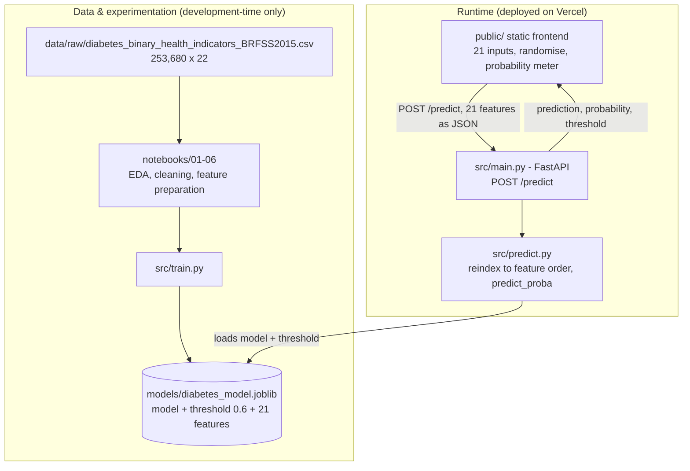

# HealthLens — CDC Diabetes Health Indicators

An end-to-end machine learning project that predicts diabetes risk from public health indicators, served through a FastAPI backend and a browser-based prediction UI.

### ▶ Try the live demo: **<https://cdc-diabetes-health-indicators.vercel.app/>**

No setup required — open the link, fill the form (or press **Randomise Inputs**), and submit. The frontend and the FastAPI backend are both deployed on Vercel.

### ▶ Run the API container: **`docker run --rm -p 8000:8000 mu3mar/healthlens-api`** — image published on [Docker Hub](https://hub.docker.com/r/mu3mar/healthlens-api)

**Author:** Muhammad Ammar · **Repository:** [mu-3mar/cdc-diabetes-health-indicators](https://github.com/mu-3mar/cdc-diabetes-health-indicators)

| | |
|---|---|
| **Live demo** | <https://cdc-diabetes-health-indicators.vercel.app/> — frontend + API on Vercel (verified responding: `POST /predict` → 200) |
| **Container image** | `mu3mar/healthlens-api:latest` on [Docker Hub](https://hub.docker.com/r/mu3mar/healthlens-api) — Python 3.12-slim, 149.4 MB (see [§10.2](#102-docker--containerised-api-image)) |
| **Task** | Binary classification (`Diabetes_binary`: 0 = no diabetes, 1 = diabetes/prediabetes) |
| **Data** | CDC Diabetes Health Indicators (BRFSS 2015) — 253,680 rows × 22 columns raw → 229,474 × 22 after cleaning |
| **Final model** | Logistic Regression (balanced), decision threshold 0.6 |
| **Final test metrics** | Accuracy 0.775 · PR-AUC 0.412 · class-1 Precision 0.366 / Recall 0.642 / F1 0.466 |
| **Stack** | Python · scikit-learn · imbalanced-learn · joblib · FastAPI/Uvicorn · vanilla HTML/CSS/JS · Docker · Vercel |
| **Status** | Deployed and working end to end. API also containerised and published to Docker Hub. No test suite. |

> **Not a medical device.** This model outputs a statistical risk estimate from survey indicators. It is **not** a diagnosis, does not replace clinical testing, and must not be used to make health decisions.
>
> **Documentation scope.** Everything below was verified by inspecting the notebooks, source, artifacts and application, by executing the model and API locally, and by calling the deployed demo as an external client. Hosting limits in [§10](#10-deployment) come from vendor documentation and are labelled as such. Anything not verifiable is marked **TODO**.

---

## Table of Contents

1. [Project Overview](#1-project-overview)
2. [Dataset](#2-dataset)
3. [Exploratory Data Analysis](#3-exploratory-data-analysis)
4. [Data Preprocessing](#4-data-preprocessing)
5. [Model Development & Evaluation](#5-model-development--evaluation)
6. [Final Model](#6-final-model)
7. [System Architecture](#7-system-architecture)
8. [Backend & Frontend](#8-backend--frontend)
9. [Installation & Usage](#9-installation--usage)
10. [Deployment](#10-deployment)
11. [Limitations & Future Improvements](#11-limitations--future-improvements)
12. [Project Structure & Technologies](#12-project-structure--technologies)

---

## 1. Project Overview

**Problem.** Diabetes and prediabetes often go undetected because diagnosis requires a blood test. Large public health surveys such as the CDC's Behavioral Risk Factor Surveillance System (BRFSS) collect cheap, self-reported indicators — blood pressure history, BMI, general health, age, activity — that correlate with diabetes status. A model that estimates risk from those indicators can support **triage and awareness**, flagging people who may benefit from an actual screening.

**Objectives**

- Explore and clean the BRFSS 2015 diabetes dataset and justify every preprocessing decision from the data.
- Establish baseline performance for several classifiers on an imbalanced target.
- Test whether class-imbalance handling (class weights, over/under-sampling, SMOTE) actually improves the metric that matters — **recall on the positive class** — rather than just accuracy.
- Tune and threshold the selected model without touching the test set until decisions are frozen.
- Ship the model behind a documented REST API and a usable web interface, and deploy it.

**Input / output.** Input is 21 numeric feature values describing one person. Output is a binary class (`0`/`1`), the positive-class probability, and the decision threshold used — so the caller can see how close the decision was.

**End-to-end workflow**

```text
BRFSS 2015 raw CSV (253,680 × 22)
   └─ 01 initial exploration ──► 02 cleaning (dedupe) ──► 03/04/05 EDA
        └─ 06 feature preparation (train/test split) ──► 07 modeling, tuning, thresholding
             └─ models/diabetes_model.joblib  {model, threshold=0.6, features}
                  └─ FastAPI (src/main.py)  ──►  Web UI  ──►  Vercel deployment
```

---

## 2. Dataset

**Source.** Downloaded from the Kaggle mirror [Diabetes Health Indicators Dataset](https://www.kaggle.com/datasets/alexteboul/diabetes-health-indicators-dataset), which distributes the file `diabetes_binary_health_indicators_BRFSS2015.csv` — the same filename the notebooks read. That dataset republishes the **CDC Diabetes Health Indicators** (BRFSS 2015), also distributed by the UCI ML Repository (dataset ID 891, DOI `10.24432/C53919`).

The data is **not** committed — `data/raw/` and `data/processed/` are git-ignored. **Download link and expected layout: [data/README.md](data/README.md).** The raw CSV in the working tree is dated `2021-11-08`; the exact download date is not recorded (**TODO**). Confirm the Kaggle/CDC/UCI usage terms before redistributing — no licence statement is included in this repository.

| Property | Value |
|---|---|
| Raw shape | 253,680 rows × 22 columns |
| Cleaned shape | 229,474 rows × 22 columns |
| Train / test split | 183,579 / 45,895 (80/20, stratified, `random_state=42`) |
| Model features | 21 (all columns except the target) |
| Missing values | 0 |
| Dtype | All columns numeric (`float64`); the published schema is integers 0/1 for binary flags |
| Target | `Diabetes_binary` — 0 = no diabetes (84.71%), 1 = diabetes/prediabetes (15.29%) |
| Class ratio | ≈ 5.5 : 1 (moderately imbalanced) |

**Features, grouped as the modeling pipeline treats them**

| Group | Columns | Notes |
|---|---|---|
| Numeric (3) | `BMI`, `MentHlth`, `PhysHlth` | `BMI` 12–98 (84 distinct values); `MentHlth`/`PhysHlth` = poor mental/physical health days in the last 30 (0–30) |
| Binary (14) | `HighBP`, `HighChol`, `CholCheck`, `Smoker`, `Stroke`, `HeartDiseaseorAttack`, `PhysActivity`, `Fruits`, `Veggies`, `HvyAlcoholConsump`, `AnyHealthcare`, `NoDocbcCost`, `DiffWalk`, `Sex` | 0/1 |
| Ordinal (4) | `GenHlth` (1 excellent → 5 poor), `Education` (1–6), `Income` (1–8), `Age` (1–13, 5-year bands) | Ordinal, **not** scaled in this project |

**Data-quality findings (from [02_data_cleaning.ipynb](notebooks/02_data_cleaning.ipynb))**

- No missing values and no out-of-range categorical codes.
- 24,206 exact duplicate rows (9.54% of the raw file) — removed.
- 1,566 feature combinations appear with **both** labels (5,218 rows); these are label conflicts, not duplicates. They were kept, which imposes an accuracy ceiling on the data itself.
- IQR outliers in `BMI` (9,847), `MentHlth` (36,208) and `PhysHlth` (40,949) were **retained** — all values are inside the survey's documented valid ranges.

---

## 3. Exploratory Data Analysis

Each numbered notebook is documented once, in the lifecycle stage where it belongs.

### 3.1 [01_initial_exploration.ipynb](notebooks/01_initial_exploration.ipynb) — Dataset inspection

**Purpose:** confirm size, schema and data quality before any transformation.

**Steps:** `shape` and `info()` → missing-value counts → duplicate count → `describe()` → target `value_counts()` → categorical value counts.

**Findings:** shape `(253,680, 22)`; zero missing values; 24,206 duplicate rows; target `218,334` zeros vs `35,346` ones (86.07% / 13.93%); `BMI` spans 12–98 with mean 28.38; `Sex` 44.0% male; `DiffWalk` 16.8%.

**Conclusion:** the file is complete but duplicated; the target is imbalanced enough that accuracy alone will be misleading. Both facts drive the rest of the project.

### 3.2 [03_univariate_analysis.ipynb](notebooks/03_univariate_analysis.ipynb) — Single-feature distributions

**Purpose:** understand each feature's shape and spot encoding problems.

**Findings (cleaned data, n = 229,474)**

- `BMI`: mean 28.69, median 27, std 6.79, skewness **2.06** — right-skewed, a minority of high-BMI records pull the tail.
- Ordinal/binary variables are dominated by a few categories: `GenHlth` = 2 (33.7%), `Education` = 6 (38.5%), `Income` = 8 (31.2%), `Age` = 9 (12.9%); rare categories exist (e.g. `Education` = 1 for 0.08%, `Income` = 1 for 4.3%).
- Binary flags are strongly one-sided: `CholCheck` 95.9% yes, `AnyHealthcare` 94.6%, but `Stroke` only 4.5% and `HvyAlcoholConsump` 6.1%.

**Conclusion:** distributions are plausible for survey data — no invalid codes. The skew in `BMI` and the very low-variance binary flags are handled later by scaling and by not over-interpreting feature importance.

### 3.3 [04_bivariate_analysis.ipynb](notebooks/04_bivariate_analysis.ipynb) — Each feature vs the target

**Purpose:** rank features by association with `Diabetes_binary` and test the numeric ones properly.

**Methods:** chi-square + Phi coefficient for binary/ordinal features; chi-square + Cramér's V for multi-level ordinal features; Mann–Whitney U with rank-biserial effect size for `BMI`/`MentHlth`/`PhysHlth`.

**Findings**

| Feature | Test | Statistic | Effect size |
|---|---|---|---|
| `GenHlth` | χ² | 18,193.70 | Cramér's V 0.282 |
| `HighBP` | χ² | 14,840.42 | Phi 0.254 |
| `DiffWalk` | χ² | 9,670.63 | Phi 0.205 |
| `HighChol` | χ² | 8,719.66 | Phi 0.195 |
| `Age` | χ² | 8,207.83 | Cramér's V 0.189 |
| `HeartDiseaseorAttack` | χ² | 6,491.59 | Phi 0.168 |
| `Income` | χ² | 4,637.20 | Cramér's V 0.142 |
| `PhysActivity` | χ² | 2,312.70 | Phi 0.100 |
| `BMI` | Mann–Whitney U | 2,220,444,097 | rank-biserial 0.349 (p ≈ 0) |

All associations are statistically significant (expected at n = 229k); the effect sizes are what matter. They are small-to-moderate, so no single feature is close to predictive on its own.

**Conclusion:** general health, blood-pressure history, walking difficulty, cholesterol and age are the leading signals; `BMI` separates the two classes most strongly among the numerics. This justified keeping the full feature set rather than aggressively pruning.

### 3.4 [05_multivariate_analysis.ipynb](notebooks/05_multivariate_analysis.ipynb) — Feature interactions

**Purpose:** check whether associations change when features are combined.

**Steps:** diabetes rate (%) by `Age × HighBP`, by `HighBP × HighChol`, and by derived `BMI` bands (`pd.cut`) against the target.

**Conclusion:** risk rises monotonically with age and with the number of coexisting risk factors — diabetes rate climbs stepwise as `HighBP`/`HighChol`/high-BMI accumulate. This supports a model that can use additive feature combinations and made a linear baseline a reasonable starting point. *(Known issue: the notebook's title cell says "04 — Multivariate Analysis"; the filename and its position in the sequence are authoritative.)*

### 3.5 EDA findings that changed the design

1. **Imbalance is real** (13.9% positives) → optimise F1 / recall / PR-AUC, never accuracy alone; evaluate resampling strategies.
2. **Associations are individually weak** → keep all 21 features, expect a modest PR-AUC rather than a near-perfect classifier.
3. **`BMI` is skewed with valid extremes** → scale it, do not clip it.
4. **Duplicates carry conflicting labels** → perfect separability is impossible; report metrics with that caveat.

---

## 4. Data Preprocessing

### 4.1 [02_data_cleaning.ipynb](notebooks/02_data_cleaning.ipynb) — Cleaning

| Step | Action | Result |
|---|---|---|
| 1 | Inspect shape / dtypes / missing values | 253,680 × 22, 0 missing |
| 2 | Identify duplicates | 24,206 duplicate rows; 35,575 rows sit in duplicate groups |
| 3 | Test label consistency inside duplicate groups | 1,566 feature combinations carry both labels (5,218 rows) |
| 4 | Drop exact duplicates (`drop_duplicates()`) | **229,474 × 22** |
| 5 | IQR outlier check on `BMI` / `MentHlth` / `PhysHlth` | 9,847 / 36,208 / 40,949 flagged — all retained (valid survey ranges) |
| 6 | Save | `data/processed/diabetes_cleaned.csv` |

**Decision:** de-duplicate only. Conflicting-label rows are real survey responses with identical answers, so removing them would discard genuine data and bias the sample; keeping them is documented as a limitation.

### 4.2 [06_feature_engineering_preparation.ipynb](notebooks/06_feature_engineering_preparation.ipynb) — Feature preparation

**Purpose:** decide what preprocessing is needed, then split and freeze the matrices.

**Steps:** load the cleaned CSV (229,474 × 22) → separate `y = Diabetes_binary`, `X` = the other 21 columns → verify no further feature engineering is required (the 14 binary flags are already 0/1; the 4 ordinals are already monotonic codes) → `train_test_split(test_size=0.2, stratify=y, random_state=42)`.

**Outputs written to `data/processed/prepared/`:** `X_train.csv` (183,579 × 21), `X_test.csv` (45,895 × 21), `y_train.csv`, `y_test.csv`. Stratification held: the training target is 84.705% / 15.295%, the test target 84.706% / 15.294%.

**Decision:** no new features were engineered. Scaling was deliberately **excluded** from this step so that it can be fitted inside the model pipeline (see below).

### 4.3 Preprocessing as actually implemented

Scaling lives **inside** the model pipeline, so cross-validation refits it per fold:

```python
numeric_features = ["BMI", "MentHlth", "PhysHlth"]

preprocessor = ColumnTransformer(
    transformers=[("num", StandardScaler(), numeric_features)],
    remainder="passthrough",   # 14 binary + 4 ordinal columns pass through unscaled
)
```

- **Fitted only on training data.** `StandardScaler` is fitted inside the pipeline (and inside `GridSearchCV`/`cross_validate` folds), never on the full dataset.
- **Encoding:** none applied — binary flags and ordinal codes are fed to Logistic Regression as numeric inputs, which is acceptable for a linear model on already-monotonic codes but leaves ordinal spacing (e.g. `Age` bands) unmodelled. Logged as a limitation.
- **Imbalance handling:** not applied to the final model's data; instead `class_weight="balanced"` is used (see [§5](#5-model-development--evaluation)). Resampling variants were evaluated with `imblearn` pipelines so that sampling happens only inside training folds.
- **Split:** single stratified 80/20 split, `random_state=42`, before any scaling.
- **Leakage risks (disclosed, not hidden):**
  - The **test set was reused** for exploratory baseline comparison in notebook 07 before tuning. The notebook states this limitation itself (§0, §5, §12, §13), and the reported test numbers are therefore optimistic relative to a pristine hold-out.
  - Threshold selection avoided the test set by carving a 20% validation split out of the training data (`random_state=42`, stratified).

---

## 5. Model Development & Evaluation

### 5.1 [07_modeling_evaluation.ipynb](notebooks/07_modeling_evaluation.ipynb) — Modeling & evaluation

**Purpose:** baseline the candidate algorithms, compare them under cross-validation, tune Logistic Regression, and select a decision threshold — using only training data for selection.

**Setup:** `StratifiedKFold(5)` on the training set; every model wrapped in a `Pipeline`; metrics = F1, recall and average precision (PR-AUC) on the positive class. Positive class = `1`.

**Baselines on the test set** — *exploratory only*, because this set was also used for later comparisons:

| Model | Accuracy | Precision (1) | Recall (1) | F1 (1) |
|---|---|---|---|---|
| Logistic Regression (unweighted) | 0.8506 | 0.5405 | 0.1532 | 0.2387 |
| Logistic Regression (`balanced`) | 0.7143 | 0.3182 | 0.7595 | 0.4485 |
| Decision Tree | 0.7739 | 0.2864 | 0.3208 | 0.3027 |
| Random Forest | 0.8431 | 0.4639 | 0.1675 | 0.2462 |
| KNN | 0.8340 | 0.4164 | 0.2133 | 0.2821 |

**Primary comparison — 5-fold CV on the training set (mean):**

| Configuration | F1 | Recall | PR-AUC |
|---|---|---|---|
| Logistic Regression, `balanced` | 0.450 | 0.754 | 0.404 |
| Logistic Regression + RandomOverSampler | 0.449 | 0.754 | 0.404 |
| Logistic Regression + RandomUnderSampler | 0.449 | 0.755 | 0.404 |
| Logistic Regression + SMOTE | 0.448 | 0.748 | 0.401 |
| Random Forest + RandomUnderSampler | 0.433 | 0.755 | 0.378 |
| Random Forest, `balanced` | 0.407 | 0.422 | 0.351 |
| Random Forest + RandomOverSampler | 0.348 | 0.298 | 0.345 |
| Random Forest + SMOTE | 0.266 | 0.189 | 0.353 |
| Decision Tree, `balanced` | 0.301 | 0.320 | 0.196 |
| KNN, `balanced` | 0.276 | 0.208 | 0.283 |
| Logistic Regression (unweighted) | 0.232 | 0.148 | **0.406** |

**Tuning.** `GridSearchCV` with the same 5-fold stratified CV, scoring F1/recall/average precision:

```python
param_grid = {
    "model__C": [0.01, 0.1, 1, 10],
    "model__class_weight": [None, "balanced"],
    "model__solver": ["lbfgs"],      # fixed, not searched
}
# Best: {'model__C': 1, 'model__class_weight': 'balanced', 'model__solver': 'lbfgs'}
# Best mean CV F1: 0.4494718286310978
```

**Threshold selection.** A 20% stratified validation split of the training set (`random_state=42`); thresholds 0.3–0.7 evaluated on validation only:

| Threshold | Precision (1) | Recall (1) | F1 (1) |
|---|---|---|---|
| 0.3 | 0.247 | 0.919 | 0.389 |
| 0.4 | 0.283 | 0.847 | 0.425 |
| 0.5 | 0.323 | 0.751 | 0.452 |
| **0.6** | **0.371** | **0.633** | **0.468** |
| 0.7 | 0.426 | 0.471 | 0.448 |

0.6 maximises validation F1 and raises precision substantially while keeping recall above 0.6 — the deliberate choice for a screening-style use case.

**Final evaluation on the test set at threshold 0.6 (single, post-decision run):**

| Metric | Value |
|---|---|
| Accuracy | 0.7749 |
| Average Precision (PR-AUC) | 0.4121 |
| Precision (class 1) | 0.366 |
| Recall (class 1) | 0.642 |
| F1 (class 1) | 0.466 |
| Confusion matrix | `[[31058, 7818], [2512, 4507]]` → TN 31,058 · FP 7,818 · FN 2,512 · TP 4,507 |

**Why this model.** Logistic Regression with balanced class weights was the best F1 configuration under cross-validation (0.450), matched by the resampling variants within noise (≤0.002) while being far simpler to deploy and inspect. Random Forest with undersampling came close on F1 (0.433) but trains and scores far larger artifacts. The unweighted model has the highest PR-AUC (0.406) yet a near-useless recall of 0.148 — ranking well while refusing to flag anyone, which is the wrong trade-off here. A linear model on scaled features therefore won on the project's own selection criterion.

**Metric discrepancy — read carefully.** The balanced Logistic Regression F1 appears as three different numbers, and all three are correct in context:

| Value | Where | Meaning |
|---|---|---|
| 0.4485 | Test set at the default 0.5 threshold, exploratory baseline | The out-of-the-box decision rule, before any tuning |
| 0.450 | 5-fold CV, threshold 0.5 | Mean cross-validated estimate used for model selection |
| 0.466 | Test set, threshold **0.6** | Final configuration, post-decision evaluation |

Never quote one without its threshold. `src/train.py` hard-codes the final configuration (`C=1`, `class_weight="balanced"`, `max_iter=2000`, `THRESHOLD=0.6`), and the saved artifact's hyperparameters match the GridSearch winner, so the app is running the tuned model — not a baseline.

---

## 6. Final Model

**Artifact:** [`models/diabetes_model.joblib`](models/diabetes_model.joblib) (3,750 bytes) — a single dict:

| Key | Type | Value |
|---|---|---|
| `model` | `sklearn.pipeline.Pipeline` | `ColumnTransformer`(StandardScaler on BMI/MentHlth/PhysHlth) → `LogisticRegression(C=1, class_weight="balanced", solver="lbfgs", max_iter=2000, random_state=42)` |
| `threshold` | `float` | `0.6` |
| `features` | `list[str]` | the 21 feature names **in training order** |

The dict format is deliberate: scaler, estimator, decision threshold and expected column order travel together, so the API cannot silently use a different threshold or a shuffled column order. It is created by [`src/train.py`](src/train.py), which reads `data/processed/prepared/X_train.csv` + `y_train.csv` and dumps the artifact.

**Expected features** (exact order enforced at inference):

```text
HighBP, HighChol, CholCheck, BMI, Smoker, Stroke, HeartDiseaseorAttack,
PhysActivity, Fruits, Veggies, HvyAlcoholConsump, AnyHealthcare, NoDocbcCost,
GenHlth, MentHlth, PhysHlth, DiffWalk, Sex, Age, Education, Income
```

**Inference** ([`src/predict.py`](src/predict.py)) — raw input is reindexed to the stored feature order, so the scaler sees columns exactly as it was fitted:

```python
def predict(input_data: dict) -> dict:
    missing_features = set(FEATURES) - set(input_data)
    if missing_features:
        raise ValueError(f"Missing features: {sorted(missing_features)}")

    input_df = pd.DataFrame([{feature: input_data[feature] for feature in FEATURES}])
    probability = float(model.predict_proba(input_df)[0, 1])
    prediction = int(probability >= THRESHOLD)
    return {"prediction": prediction, "probability": round(probability, 4), "threshold": THRESHOLD}
```

**What the app returns:** a class label (`0`/`1`), the positive-class probability rounded to 4 dp, and the threshold — never a bare "yes/no". Example (verified against both the local API and the deployed demo):

```json
{ "prediction": 1, "probability": 0.6996, "threshold": 0.6 }
```

**Compatibility.** Trained and verified with scikit-learn 1.9.1 / joblib 1.6.0. Loading the artifact under a different scikit-learn version may emit `InconsistentVersionWarning`; pin the version or retrain (see [§9](#9-installation--usage)).

**Verification level.** The artifact was loaded and executed locally, its keys/params/threshold/feature order inspected, and the live API returned matching predictions. Training-vs-serving preprocessing **is** consistent: both use the pipeline stored inside the artifact.

---

## 7. System Architecture



The notebooks and `src/train.py` are offline/development-time only; the runtime path is artifact → API → browser. Training and serving share one artifact, which is what keeps their preprocessing identical. In the deployment, `public/` and `src/main.py` are served by the **same Vercel origin**, so the browser talks to the API without any cross-origin request.

---

## 8. Backend & Frontend

### 8.1 API ([`src/main.py`](src/main.py))

| Method | Path | Purpose | Request | Response |
|---|---|---|---|---|
| `GET` | `/` | Liveness check | — | `{"message": "Diabetes Prediction API is running"}` |
| `POST` | `/predict` | Predict | `{"features": {<21 numeric fields>}}` | `{"prediction": 0\|1, "probability": float, "threshold": 0.6}` |

There is **no** `/health` endpoint — `/` serves that purpose, and it does not check the artifact.

**Deployed behaviour.** On Vercel the API and the static frontend share one origin, and the static page takes precedence for `GET /`:

```bash
GET  https://cdc-diabetes-health-indicators.vercel.app/            # 200 text/html  (frontend)
POST https://cdc-diabetes-health-indicators.vercel.app/predict     # 200 application/json
GET  https://cdc-diabetes-health-indicators.vercel.app/openapi.json# 200  (FastAPI schema)
GET  https://cdc-diabetes-health-indicators.vercel.app/predict     # 405  (POST-only route)
```

All four responses were verified from outside the deployment. The OpenAPI schema reports the app as `Diabetes Prediction API` v1.0.0 with paths `/` and `/predict`.

**Request schema.** Pydantic model with `features: dict[str, float]`. All 21 keys must be present; unknown keys are ignored.

```bash
curl -X POST https://cdc-diabetes-health-indicators.vercel.app/predict \
  -H "Content-Type: application/json" \
  -d '{"features":{"HighBP":1,"HighChol":1,"CholCheck":1,"BMI":31,"Smoker":0,"Stroke":0,
       "HeartDiseaseorAttack":0,"PhysActivity":1,"Fruits":1,"Veggies":1,"HvyAlcoholConsump":0,
       "AnyHealthcare":1,"NoDocbcCost":0,"GenHlth":3,"MentHlth":4,"PhysHlth":6,"DiffWalk":0,
       "Sex":1,"Age":9,"Education":5,"Income":6}}'
```

**Validation & errors.**

- Missing feature names → the API raises a 422 whose `detail` lists the missing fields (`"Missing features: [...]"`) — verified by calling the endpoint with an incomplete payload.
- A malformed body (missing `features`, non-numeric values) → FastAPI's standard 422 schema validation error.
- Range checks are **not** enforced server-side (e.g. a negative `BMI` is accepted and will produce a meaningless probability). This is a known gap, listed in [§11](#11-limitations--future-improvements).
- Model loading is a module-level import (`_ensure_loaded()` in `predict.py`); if the artifact is unreadable the app fails at import/startup rather than per request.

**CORS.** `CORSMiddleware` allows `http://127.0.0.1:5500`, `http://localhost:5500` and the literal origin `"null"` (which browsers send for `file://` pages). This only matters for **local development** — the deployed frontend calls a same-origin API, so no preflight is involved. `allow_credentials=True` combined with `"null"` is loose by default; tighten both if the API is ever exposed to other origins.

### 8.2 Web frontend ([`frontend/`](frontend), [`public/`](public))

Static, dependency-free HTML/CSS/JS — three files plus a logo widget. **`frontend/` and `public/` are byte-identical copies**: `frontend/` is the working copy, `public/` is Vercel's static output directory. Edit one, copy to the other.

| UI control | Features |
|---|---|
| Numeric inputs / sliders | `BMI` (12–60), `MentHlth`, `PhysHlth` (0–30) |
| Dropdowns | `Age`, `Education`, `Income`, and `GenHlth` |
| Mutually exclusive radio pair | `Sex` (Female/Male — selecting one deselects the other, default Female only) |
| Checkboxes (13) | `HighBP`, `HighChol`, `CholCheck`, `Smoker`, `Stroke`, `HeartDiseaseorAttack`, `PhysActivity`, `Fruits`, `Veggies`, `HvyAlcoholConsump`, `AnyHealthcare`, `NoDocbcCost`, `DiffWalk` |

Behaviour worth knowing:

- **`GenHlth` is displayed inverted.** The dropdown shows Excellent→Poor for humans and sends `6 - selected` to match the survey's 1–5 encoding.
- **Randomise Inputs** fills every control with random but valid values and clears any previous result.
- **Prediction flow:** collect → build the 21-key `features` object → `POST ${API_BASE}/predict` → render probability bar, predicted class, and a disclaimer. Network or HTTP errors surface as a readable message instead of a silent failure.
- **API status pill:** on load the page calls `GET ${API_BASE}/` and shows a live indicator (`#api-status`). On Vercel that request hits the static page, not the API's root handler, so the pill reflects reachability rather than model health.
- **Design system:** tokens in [`styles.css`](frontend/styles.css) — background `#fff8f5`, accent `#f04b24`, success `#15803d`, dark text `#29201d`. The animated logo is a self-contained SVG ([`logo-animated.html`](frontend/logo-animated.html), ~207 KB) embedded in an `iframe`, supporting `?color=#RRGGBB`; it does not affect prediction logic.
- **API URL:** `API_BASE = ""` on line 1 of [`app.js`](frontend/app.js#L1) — an empty base means *same origin*, which is what the Vercel deployment relies on. To point the UI at a different backend, set it to that backend's absolute URL.

> `127.0.0.1` always means *the machine running the browser*. If you serve the frontend locally while the API runs elsewhere, set `API_BASE` to the API's absolute URL — and add the frontend's origin to the API's CORS list.

---

## 9. Installation & Usage

**Prerequisites.** Python 3.10+ (verified with 3.12.14; `pyproject.toml` requires ≥3.12). No Node.js required — the frontend is static. The dataset is required to retrain; the trained artifact is already committed.

```bash
# 1. Clone
git clone https://github.com/mu-3mar/cdc-diabetes-health-indicators.git
cd cdc-diabetes-health-indicators

# 2. Create an environment
python -m venv .venv && source .venv/bin/activate     # macOS/Linux
# python -m venv .venv && .venv\Scripts\activate      # Windows

# 3. Install dependencies
pip install -r requirements.txt        # fastapi uvicorn joblib pandas scikit-learn numpy (unpinned)
# For exact reproducibility (notebooks + serving), pin instead:
#   pip install "scikit-learn==1.9.1" "pandas==3.0.6" "numpy==2.5.3" "scipy==1.18.1" \
#               "joblib==1.6.0" "fastapi==0.162.0" "uvicorn==0.54.0" "imbalanced-learn==0.14.2"

# 4. Place the dataset  (only needed to retrain)
#    Download from https://www.kaggle.com/datasets/alexteboul/diabetes-health-indicators-dataset
#    and put diabetes_binary_health_indicators_BRFSS2015.csv at:
#    data/raw/diabetes_binary_health_indicators_BRFSS2015.csv
```

> **Dependency notes.** [`requirements.txt`](requirements.txt) lists the six packages the **API** needs, without version pins. [`pyproject.toml`](pyproject.toml) declares the same set plus `[tool.vercel] entrypoint = "src.main:app"` for the deployment. Neither includes `scipy` (imported indirectly by scikit-learn) or `imbalanced-learn`/`matplotlib`/`seaborn` (needed only by the notebooks). [`environment.yml`](environment.yml) is stale — it is named `water-potability`, omits several packages and carries a hard-coded `prefix`.

```bash
# 5. (Optional) Retrain - reproduces models/diabetes_model.joblib
#    Requires data/processed/diabetes_cleaned.csv and data/processed/prepared/*.csv
#    (produced by notebooks 02 and 06).
python src/train.py

# 6. Start the API  (run from the repository root)
uvicorn src.main:app --reload
# -> http://127.0.0.1:8000          interactive docs: /docs

# 7. Serve the frontend  (in a second terminal)
python -m http.server 5500 --directory frontend
# -> http://127.0.0.1:5500      (serve `public/` instead to preview exactly what Vercel hosts)
```

**Verify the full flow**

```bash
curl http://127.0.0.1:8000/          # {"message":"Diabetes Prediction API is running"}
# then POST /predict as shown in 8.1 - expect {"prediction":..., "probability":..., "threshold":0.6}
```

Open `http://127.0.0.1:5500`, fill the form (or press **Randomise Inputs**), submit, and confirm a probability appears. The frontend uses a same-origin `API_BASE`, so to test it locally against the local API set `API_BASE = "http://127.0.0.1:8000"` in `app.js`.

**Reproducing from raw data:** run the notebooks in order, `01 → 07`. Notebooks 02 and 06 write the CSVs that `src/train.py` consumes; notebook 07 produces the metrics in [§5](#5-model-development--evaluation) and is by far the slowest, since its exploratory cells re-fit several models.

---

## 10. Deployment

### 10.1 Current status — live on Vercel

**Deployed and verified working:** <https://cdc-diabetes-health-indicators.vercel.app/>

| Piece | How it is configured in the repository |
|---|---|
| Frontend | [`public/`](public) served as static output (`index.html`, `app.js`, `styles.css`, `logo-animated.html`) |
| Backend | [`src/main.py`](src/main.py) as a Python function, wired by `[tool.vercel] entrypoint = "src.main:app"` in [`pyproject.toml`](pyproject.toml) |
| Python deps | [`requirements.txt`](requirements.txt) (also declared in `pyproject.toml`) |
| Routing | [`vercel.json`](vercel.json) — currently `{}` (Vercel defaults; frontend at `/`, API at `/predict`) |
| Model artifact | [`models/diabetes_model.joblib`](models/diabetes_model.joblib) is committed, so the function can load it at cold start |
| Browser → API | `API_BASE = ""` in `app.js` → **same origin**, so no CORS preflight in production |

**Verified from outside** (`GET /` → 200 HTML; `POST /predict` → 200 with `{"prediction":1,"probability":0.6996,"threshold":0.6}` in ≈0.5 s; `/openapi.json` → 200; `GET /predict` → 405).

**Known characteristics of this deployment**

- **Cold starts.** The first request after idle has to initialise a scientific-Python runtime and load the model — expect noticeably higher latency than the ≈0.5 s warm figure.
- **No custom domain or health monitoring**, and the deployment is only partly reproducible from the repo: `vercel.json` is empty, so project settings (root directory, build settings) live in the Vercel dashboard, not in git. **TODO:** export that configuration into `vercel.json`.
- **Free-plan resource limits** apply (below) — fine for a demo, not sized for production traffic.

### 10.2 Docker — containerised API image

The API ships as a self-contained image built from [`Dockerfile`](Dockerfile) and published to Docker Hub as **[`mu3mar/healthlens-api`](https://hub.docker.com/r/mu3mar/healthlens-api)**.

| Piece | Value |
|---|---|
| Image | `mu3mar/healthlens-api:latest` (Docker Hub, size ≈149.4 MB) |
| Base image | `python:3.12-slim` |
| Baked in at build | `requirements.txt` (installed), `src/` (app + predict + train), `models/diabetes_model.joblib` |
| Entrypoint | `uvicorn src.main:app --host 0.0.0.0 --port 8000` |
| Serves | the REST API only (`GET /`, `POST /predict`) — the static frontend is **not** baked in; serve `public/` separately (Vercel, a static server, or a reverse proxy in front of the container) |

**Run the published image**

```bash
docker run --rm -p 8000:8000 mu3mar/healthlens-api
# -> http://127.0.0.1:8000          interactive docs: /docs
```

Then call it exactly as in [§8.1](#81-api-srcmainpy), swapping the host for `http://127.0.0.1:8000`.

**Build it yourself**

```bash
docker build -t mu3mar/healthlens-api .
docker run --rm -p 8000:8000 mu3mar/healthlens-api
```

**Notes**

- The image is API-only and depends only on the committed artifact — it needs neither the dataset nor the notebooks.
- It listens on `0.0.0.0:8000`; map it to any host port with `-p <host>:8000`.
- A locally built image targets your machine's architecture. Use `docker buildx build --platform linux/amd64,linux/arm64` if you need multi-arch (e.g. to run on the Arm-based OCI instance in [§10.4](#104-alternative-oracle-cloud-infrastructure-always-free)).
- The published layer set is not reproducible from the repo alone unless `requirements.txt` is pinned — see [§11](#11-limitations--future-improvements).

### 10.3 Vercel limits this deployment lives within

| Limit (Hobby plan) | Value | Implication here |
|---|---|---|
| Max function duration | 300 s (default and maximum) | Peak usage is far below this; cold start dominates latency |
| Memory / CPU | 2 GB / 1 vCPU, fixed | Ample — the artifact is 3.75 KB |
| Bundle size (uncompressed) | 250 MB, 500 MB for Python (up to 5 GB via *Large functions*, beta) | scikit-learn + SciPy + pandas + joblib must fit; verify in the dashboard rather than assuming |
| Request/response payload | 4.5 MB | Irrelevant for 21 scalars |
| Concurrency | Auto-scales | Fine |
| Region | Single region by default (`iad1`) | Higher latency for users outside the US unless the region is changed |

Source: [Vercel Functions limits](https://vercel.com/docs/functions/limitations). Verify against the official page before relying on any number.

### 10.4 Alternative: Oracle Cloud Infrastructure (Always Free)

Not implemented — this is the option to consider if you need an always-on process instead of serverless.

- **Fits the application well.** An always-on Linux VM can run Uvicorn (directly or in Docker) 24/7 with no cold starts and no per-request limits.
- **Always Free compute.** A1.Flex (Arm): **1,500 OCPU-hours + 9,000 GB-hours per month**, i.e. the equivalent of **2 OCPUs / 12 GB** running continuously, or two 1-OCPU instances. This was **halved from 4 OCPUs / 24 GB (3,000 / 18,000) in June 2026**; some official pages still display the older figures, so confirm your tenancy's quota in the console. Also included: two AMD micro instances (`VM.Standard.E2.1.Micro`), 200 GB block storage (min 47 GB boot volume per instance), and 10 TB/month outbound.
- **Constraints to plan for:** Arm64 images only (verify every wheel builds for `aarch64`), capacity is not guaranteed in a given availability domain ("out of host capacity" is common), no SLA, and idle Always Free instances can be reclaimed (roughly: CPU 95th-percentile < 20%, network < 20% and memory < 20% sustained over ~7 days).
- **Networking/security to add:** open only 443 (and 22 for SSH) in both the VCN security list *and* the instance firewall; put Nginx or Caddy in front of Uvicorn; TLS via Let's Encrypt; run Uvicorn bound to `127.0.0.1` behind the proxy; add the frontend's origin to CORS; use `systemd` or a container restart policy.

Source: [OCI Always Free resources](https://docs.oracle.com/en-us/iaas/Content/FreeTier/freetier_topic-Always_Free_Resources.htm).

### 10.5 Remaining deployment work

Done: ✅ frontend + API live on Vercel · ✅ same-origin API wiring · ✅ dependencies declared · ✅ artifact committed · ✅ endpoints verified externally · ✅ API containerised and image published to Docker Hub.

Remaining, in priority order:

1. [ ] Capture the Vercel project settings in `vercel.json` so a redeploy is reproducible from git.
2. [ ] Pin dependency versions in `requirements.txt` to match the trained artifact (this also makes the Docker image reproducible).
3. [ ] Harden the API: enforce input ranges, drop the `"null"` CORS origin, add real logging and a `/health` that checks the model.
4. [ ] Add a custom domain and uptime monitoring; document rollback (Vercel instant rollback to a previous deployment).
5. [ ] (Optional) Move the API to an OCI Always Free VM per [§10.4](#104-alternative-oracle-cloud-infrastructure-always-free) if cold starts become unacceptable — the published image can be tagged and pushed there directly.

---

## 11. Limitations & Future Improvements

**Technical limitations (verified in the repository)**

- **Test-set reuse.** Baselines in notebook 07 were compared on the test set before tuning, so final metrics are mildly optimistic. The notebook discloses this; a clean re-split should confirm the numbers.
- **Label conflicts.** 5,218 rows share identical features with opposite labels — a hard accuracy ceiling that no model can remove.
- **No server-side input validation.** `/predict` accepts any float, including impossible values (negative BMI, `GenHlth` = 99).
- **Ordinal features are treated as plain numbers** (not scaled, not one-hot, not target-encoded), so the model assumes equal, linear spacing between e.g. `Age` bands.
- **Accuracy is dominated by the majority class**; PR-AUC 0.412 and precision 0.366 mean roughly two in three positive flags are false alarms at threshold 0.6.
- **Public API with a loose CORS default:** the `"null"` origin is allowed with `allow_credentials=True`, there is no authentication, no rate limiting, no structured logging and no `/health` endpoint.
- **Frontend duplication.** `frontend/` and `public/` are identical copies kept in sync by hand — they will drift. A build step (or a single source directory) would remove the hazard.
- **Dependencies are unpinned** in `requirements.txt`, so a redeploy can silently pick up new library versions that may not match the trained artifact.
- **Minor documentation defects:** notebook 05's title cell reads "04"; notebook 07 §11 refers to a "previous threshold analysis" that does not exist in the notebook; `src/main.py` imports `CORSMiddleware` twice.

**Future improvements, in priority order**

1. **Add a test suite** — at minimum: artifact key/shape checks, a `/predict` contract test, a "missing feature → 422" test, and a regression test locking the feature order. None exist today.
2. **Make the deployment reproducible** — filled-in `vercel.json`, pinned dependencies, and CI that runs the tests before deploying.
3. **Harden the API** — range validation via Pydantic constraints, strict CORS, authentication, rate limiting, a real `/health`.
4. **Re-split and re-evaluate** onto a genuinely untouched hold-out to publish honest final numbers.
5. **Improve the model honestly** — probability calibration, non-linear models with cost-sensitive tuning, or ordinal-aware encoding for `Age`/`Education`/`Income`; compare against the current PR-AUC 0.412 rather than against accuracy.
6. **Remove the `frontend/` ↔ `public/` duplication** and surface the *prevalence* context (PR-AUC vs. the 15.3% base rate) in the UI.
7. **Finish packaging** — the `Dockerfile` and the Docker Hub image exist ([§10.2](#102-docker--containerised-api-image)); still missing are a rebuild script for the artifact and a `docker-compose.yml` that runs the API and the static frontend together.

---

## 12. Project Structure & Technologies

```text
cdc-diabetes-health-indicators/
├── README.md                                  # this document
├── requirements.txt                           # runtime deps for the API (unpinned)
├── pyproject.toml                             # project metadata + [tool.vercel] entrypoint
├── vercel.json                                # Vercel config (currently empty)
├── Dockerfile                                 # python:3.12-slim image for the API (see 10.2)
├── environment.yml                            # stale/incomplete - see 9
├── .gitignore                                 # ignores data/raw, data/processed, caches, venv
├── notebooks/                                 # the full experimentation lifecycle
│   ├── 01_initial_exploration.ipynb           # shape, missing values, duplicates, target balance
│   ├── 02_data_cleaning.ipynb                 # dedupe + IQR review -> diabetes_cleaned.csv
│   ├── 03_univariate_analysis.ipynb           # per-feature distributions
│   ├── 04_bivariate_analysis.ipynb            # chi-square / Phi / Cramer's V / Mann-Whitney
│   ├── 05_multivariate_analysis.ipynb         # feature interactions vs diabetes rate
│   ├── 06_feature_engineering_preparation.ipynb  # review, 80/20 stratified split, save prepared CSVs
│   └── 07_modeling_evaluation.ipynb           # baselines, CV, GridSearch, thresholds, final evaluation
├── src/
│   ├── train.py                               # fits the final pipeline, dumps {model, threshold, features}
│   ├── predict.py                             # loads the artifact, validates input, predict_proba
│   └── main.py                                # FastAPI app: GET /, POST /predict, CORS
├── models/
│   └── diabetes_model.joblib                  # 3,750 B - the served artifact
├── frontend/                                  # working copy of the UI
│   ├── index.html                             # form with 21 model inputs
│   ├── app.js                                 # API_BASE, payload build, result rendering
│   ├── styles.css                             # design tokens, layout, probability meter
│   └── logo-animated.html                     # self-contained animated SVG logo widget
├── public/                                    # identical copy deployed by Vercel as static output
└── data/                                      # dataset files are git-ignored
    ├── README.md                              # dataset download link and layout (tracked)
    ├── raw/diabetes_binary_health_indicators_BRFSS2015.csv   # 253,680 x 22 (download it)
    └── processed/
        ├── diabetes_cleaned.csv               # 229,474 x 22 (notebook 02)
        └── prepared/{X_train,X_test,y_train,y_test}.csv      # notebook 06
```

Not present (verified): `tests/`, `docker-compose.yml`, `.dockerignore`, `.github/workflows/`, any `LICENSE`, or any `CI` configuration.

| Layer | Technologies actually used |
|---|---|
| Data & analysis | pandas, NumPy, Matplotlib/Seaborn, SciPy |
| Modeling | scikit-learn (`Pipeline`, `ColumnTransformer`, `StandardScaler`, `LogisticRegression`, `RandomForestClassifier`, `DecisionTreeClassifier`, `KNeighborsClassifier`, `GridSearchCV`, `StratifiedKFold`, `cross_validate`), imbalanced-learn (`Pipeline`, `RandomOverSampler`, `RandomUnderSampler`, `SMOTE`) |
| Persistence | joblib |
| Backend | FastAPI, Pydantic, Uvicorn |
| Frontend | HTML5, CSS3 (custom properties), vanilla JavaScript, inline SVG |
| Deployment | Vercel (static hosting + Python function), `vercel.json`, `pyproject.toml`; Docker (`Dockerfile`) + Docker Hub for the API image `mu3mar/healthlens-api` |
| Tooling | Jupyter, Git/GitHub |

---

### Author & credits

**Muhammad Ammar** — design, EDA, modeling, API, frontend, deployment.

Live demo: <https://cdc-diabetes-health-indicators.vercel.app/>

Data: CDC Diabetes Health Indicators, distributed by the UCI Machine Learning Repository (BRFSS 2015; DOI `10.24432/C53919`) and downloaded from the [Kaggle mirror](https://www.kaggle.com/datasets/alexteboul/diabetes-health-indicators-dataset). Libraries credited to their respective open-source projects. No other collaborators, affiliations or certifications are claimed.

**Remaining TODOs:** record the dataset's download date and confirm its usage/licence terms, add a `LICENSE` file, commit the Vercel project configuration, and add the test suite described in [§11](#11-limitations--future-improvements).
