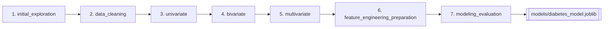
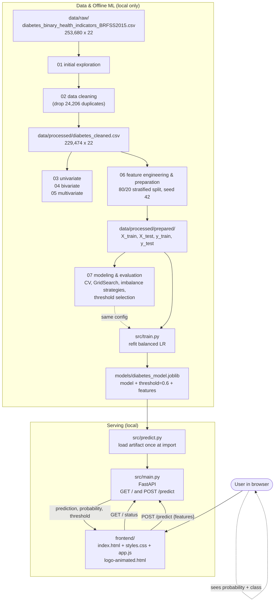
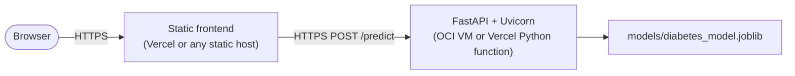

# HealthLens — CDC Diabetes Health Indicators

**An end-to-end machine learning project: exploratory analysis → cleaning → EDA → feature preparation → model selection → tuning → a trained artifact → a FastAPI inference service → a browser front end.**

**Author:** Muhammad Ammar
**Repository:** [github.com/mu-3mar/cdc-diabetes-health-indicators](https://github.com/mu-3mar/cdc-diabetes-health-indicators) (branch `main`)
**Project type:** Binary classification (imbalanced target) with a REST API and a static web UI
**Status:** Local end-to-end prediction flow verified working. **Not deployed.**

> **Medical disclaimer:** HealthLens is an educational machine-learning demonstration, not a medical device. Its output is **not** a diagnosis, does not rule diabetes in or out, and must not be used to make treatment or medical decisions. Consult a qualified healthcare professional for medical advice.

---

## Table of Contents

1. [Documentation Verification Status](#1-documentation-verification-status)
2. [Project Overview](#2-project-overview)
3. [Dataset and Data Understanding](#3-dataset-and-data-understanding)
4. [Notebook-by-Notebook Documentation](#4-notebook-by-notebook-documentation)
   - [4.1 `01_initial_exploration.ipynb`](#41-01_initial_explorationipynb)
   - [4.2 `02_data_cleaning.ipynb`](#42-02_data_cleaningipynb)
   - [4.3 `03_univariate_analysis.ipynb`](#43-03_univariate_analysisipynb)
   - [4.4 `04_bivariate_analysis.ipynb`](#44-04_bivariate_analysisipynb)
   - [4.5 `05_multivariate_analysis.ipynb`](#45-05_multivariate_analysisipynb)
   - [4.6 `06_feature_engineering_preparation.ipynb`](#46-06_feature_engineering_preparationipynb)
   - [4.7 `07_modeling_evaluation.ipynb`](#47-07_modeling_evaluationipynb)
5. [Preprocessing and Feature Engineering](#5-preprocessing-and-feature-engineering)
6. [Final Model and Inference Pipeline](#6-final-model-and-inference-pipeline)
7. [FastAPI Backend](#7-fastapi-backend)
8. [Web Frontend](#8-web-frontend)
9. [Architecture and End-to-End Data Flow](#9-architecture-and-end-to-end-data-flow)
10. [Installation and Local Setup](#10-installation-and-local-setup)
11. [Testing and Troubleshooting](#11-testing-and-troubleshooting)
12. [Dockerization (Planned — Not Implemented)](#12-dockerization-planned--not-implemented)
13. [Deployment Strategy](#13-deployment-strategy)
14. [Security, Privacy, and Responsible Use](#14-security-privacy-and-responsible-use)
15. [Repository Structure](#15-repository-structure)
16. [Results, Limitations, and Future Improvements](#16-results-limitations-and-future-improvements)
17. [Author and Credits](#17-author-and-credits)
18. [Known Inconsistencies and TODOs](#18-known-inconsistencies-and-todos)

---

## 1. Documentation Verification Status

This README was produced by inspecting the repository as it exists on disk, executing the model artifact, and calling the FastAPI application's routes. To keep the document honest, the provenance of each claim is labelled:

| Label | Meaning |
|---|---|
| **[Verified — repository]** | Read directly from a file tracked in this repository. |
| **[Verified — runtime]** | Confirmed by executing code against the artifact/API during this documentation pass (2026-10-26). |
| **[External research]** | Sourced from current official documentation on the web; not derivable from the repository. |
| **[Inference]** | A reasonable conclusion drawn from code, but not directly asserted anywhere. |
| **[TODO / unverified]** | Not provable from the repository; must be confirmed before it is relied upon. |

**Runtime checks performed while writing this document** (conda env `cdc`, Python 3.12.14):

- Loaded `models/diabetes_model.joblib` and printed its keys, threshold, feature list, pipeline steps, and estimator hyperparameters. **[Verified — runtime]**
- Called `predict_diabetes(...)` directly with a full 21-feature payload. **[Verified — runtime]**
- Called `GET /` and `POST /predict` through `fastapi.testclient.TestClient`. **[Verified — runtime]**
- Called `POST /predict` with an incomplete payload to confirm the error path. **[Verified — runtime]**

**NOT performed:** no Docker build, no public deployment, no load testing, no calibration analysis, no clinical validation.

---

## 2. Project Overview

### Problem statement

Diabetes and prediabetes are widespread and frequently undiagnosed. Public-health surveys such as the CDC's Behavioral Risk Factor Surveillance System (BRFSS) collect self-reported indicators (blood pressure, cholesterol, BMI, general health, lifestyle, healthcare access). The question this project addresses is:

> Given 21 survey-based health indicators, can a model distinguish respondents recorded as diabetes/prediabetes (`1`) from those recorded as not (`0`), and can that model be exposed as a usable web tool?

### Why it matters

- It is a realistic **imbalanced binary classification** problem (≈15% positive class), which is where accuracy-only evaluation misleads.
- It exercises the full applied-ML lifecycle: analysis → cleaning → EDA → feature preparation → model comparison → tuning → threshold selection → artifact packaging → serving → UI.
- It is a good vehicle for demonstrating the difference between a *model probability*, a *thresholded class*, and a *medical diagnosis*.

### Objectives

The goals actually pursued in the notebooks and code (as opposed to aspirational goals):

1. Explore and clean the BRFSS 2015 diabetes health-indicators data. **[Notebooks 01–02]**
2. Characterise features and their relationship with the target (univariate, bivariate, multivariate). **[Notebooks 03–05]**
3. Prepare a reproducible stratified train/test split. **[Notebook 06]**
4. Compare baseline classifiers and class-imbalance strategies using stratified cross-validation. **[Notebook 07]**
5. Tune the leading candidate and select a decision threshold on validation data. **[Notebook 07]**
6. Persist the final pipeline as a single artifact and serve it via FastAPI. **[`src/train.py`, `src/predict.py`, `src/main.py`]**
7. Provide a browser UI for entering indicators and viewing the model output. **[`frontend/`]**

### Machine learning task

| Item | Value |
|---|---|
| Task | Binary classification |
| Target variable | `Diabetes_binary` |
| Encoding | `0` = no diabetes, `1` = prediabetes **or** diabetes |
| Positive class | `1` (used for precision, recall, F1, average precision) |
| Number of input features | 21 |
| Class balance (after cleaning) | ≈ 84.71% class `0`, ≈ 15.29% class `1` |

### Intended input and output

- **Input:** a JSON object with 21 numeric indicator values (see [§7](#7-fastapi-backend) for the exact schema).
- **Output:** `{"prediction": 0|1, "probability": <float 0–1>, "threshold": 0.6}`.

### End-to-end workflow

```
Raw CSV (BRFSS2015)
   → 01 exploration      → 02 cleaning            → 03/04/05 EDA
   → 06 split + prepared CSVs
   → 07 model comparison, tuning, threshold selection, final evaluation
   → src/train.py  → models/diabetes_model.joblib
   → src/predict.py → src/main.py (FastAPI)
   → frontend/ (HTML/CSS/JS) → user sees probability + thresholded result
```

### Main technologies actually used

| Layer | Technology |
|---|---|
| Language | Python 3.12.14 |
| Data / analysis | pandas, NumPy, SciPy (statistical tests) |
| ML | scikit-learn (pipelines, models, metrics, `GridSearchCV`) |
| Imbalance | imbalanced-learn (`RandomOverSampler`, `SMOTE`, `RandomUnderSampler`) |
| Persistence | joblib |
| API | FastAPI + Uvicorn, Pydantic request model |
| Frontend | Plain HTML + CSS + JavaScript (no framework, no build step) |
| Environment | Conda (env name `cdc` on the author's machine) |

### Key deliverables

| Deliverable | Path | Status |
|---|---|---|
| 7 analysis/modelling notebooks | [`notebooks/`](notebooks) | Present |
| Training script | [`src/train.py`](src/train.py) | Present |
| Inference module | [`src/predict.py`](src/predict.py) | Present |
| FastAPI app | [`src/main.py`](src/main.py) | Present |
| Saved model artifact | [`models/diabetes_model.joblib`](models/diabetes_model.joblib) | Present (3,750 bytes) |
| Web UI | [`frontend/`](frontend) | Present |
| Dependency spec | [`environment.yml`](environment.yml) | Present but **incomplete/misnamed** (see [§10](#10-installation-and-local-setup)) |
| Docker / deployment config | — | **Not present** |
| Automated tests | — | **Not present** |

---

## 3. Dataset and Data Understanding

### Name and provenance

The project uses the **CDC Diabetes Health Indicators** dataset (the `diabetes_binary` variant), derived from the CDC's **2015 Behavioral Risk Factor Surveillance System (BRFSS)**. **[External research]**

- Upstream distribution: UCI Machine Learning Repository, dataset 891 — <https://archive.ics.uci.edu/dataset/891/cdc+diabetes+health+indicators> (DOI `10.24432/C53919`).
- The same prepared file is also widely mirrored on Kaggle.

**Important caveat about provenance:** this repository contains **no download script, no `curl`/`wget` command, and no URL anywhere in code or notebooks**. The file is referenced only as a local path:

```python
df = pd.read_csv("../data/raw/diabetes_binary_health_indicators_BRFSS2015.csv")
```

Therefore the exact acquisition URL used by the author **[TODO / unverified]**. What *is* verified is the filename, the shape, and the column set, which match the UCI/Kaggle `diabetes_binary_health_indicators_BRFSS2015.csv` distribution. **[Verified — repository + inference]**

### Acquisition method (as the repository expects it)

- Place the raw CSV at `data/raw/diabetes_binary_health_indicators_BRFSS2015.csv`.
- A `.zip` of the same file is present locally (`data/raw/diabetes_binary_health_indicators_BRFSS2015.csv.zip`) but is **git-ignored** and is not part of the repository.
- `data/` (both `raw/` and `processed/`) is excluded by [`.gitignore`](.gitignore), so **a fresh clone contains no data and cannot run any notebook or `src/train.py` until the data is supplied.**

### Size and dimensions

| Stage | Rows | Columns | Source |
|---|---:|---:|---|
| Raw file | 253,680 | 22 | [`01_initial_exploration.ipynb`](notebooks/01_initial_exploration.ipynb) `df.shape` |
| After removing exact duplicates | 229,474 | 22 | [`02_data_cleaning.ipynb`](notebooks/02_data_cleaning.ipynb) |
| Feature matrix `X` | 229,474 | 21 | [`06_feature_engineering_preparation.ipynb`](notebooks/06_feature_engineering_preparation.ipynb) |
| `X_train` / `X_test` | 183,579 / 45,895 | 21 | Notebook 06 (80/20 split) |

Memory footprint reported by pandas: 42.6 MB (raw), 38.5 MB (cleaned).

Note: the UCI page describes "35 features" in its prose but its variable table lists 23 columns (an `ID` column plus 21 features plus the target). The file used here has **22 columns** (21 features + target, no `ID`). **[Verified — repository]** — the discrepancy is on the dataset-publisher side, not in this project.

### Feature names, definitions, types

All 22 columns are stored as `float64`, even though they represent three different statistical types.

| # | Feature | Type | Meaning / encoding | Range in data |
|---|---|---|---|---|
| 0 | `Diabetes_binary` | **Target** | 0 = no diabetes; 1 = prediabetes or diabetes | {0, 1} |
| 1 | `HighBP` | Binary | Ever told you had high blood pressure | {0, 1} |
| 2 | `HighChol` | Binary | Ever told you had high cholesterol | {0, 1} |
| 3 | `CholCheck` | Binary | Cholesterol checked within past 5 years | {0, 1} |
| 4 | `BMI` | Continuous | Body Mass Index (no unit documented in the file) | 12–98 |
| 5 | `Smoker` | Binary | Smoked ≥100 cigarettes in life | {0, 1} |
| 6 | `Stroke` | Binary | Ever had a stroke | {0, 1} |
| 7 | `HeartDiseaseorAttack` | Binary | Coronary heart disease or myocardial infarction | {0, 1} |
| 8 | `PhysActivity` | Binary | Leisure-time physical activity in past 30 days | {0, 1} |
| 9 | `Fruits` | Binary | Fruit ≥1 time/day | {0, 1} |
| 10 | `Veggies` | Binary | Vegetables ≥1 time/day | {0, 1} |
| 11 | `HvyAlcoholConsump` | Binary | Heavy drinker (men >14/week, women >7/week) | {0, 1} |
| 12 | `AnyHealthcare` | Binary | Has any healthcare coverage | {0, 1} |
| 13 | `NoDocbcCost` | Binary | Could not see a doctor in past 12 months due to cost | {0, 1} |
| 14 | `GenHlth` | Ordinal (5) | 1 = excellent, 2 = very good, 3 = good, 4 = fair, 5 = poor | 1–5 |
| 15 | `MentHlth` | Count | Days (of past 30) mental health was not good | 0–30 |
| 16 | `PhysHlth` | Count | Days (of past 30) physical health was not good | 0–30 |
| 17 | `DiffWalk` | Binary | Serious difficulty walking or climbing stairs | {0, 1} |
| 18 | `Sex` | Binary | 0 = female, 1 = male | {0, 1} |
| 19 | `Age` | Ordinal (13) | 13-level age bracket, 1 = 18–24 … 13 = 80+ | 1–13 |
| 20 | `Education` | Ordinal (6) | 1 = never attended/kindergarten … 6 = college 4+ years | 1–6 |
| 21 | `Income` | Ordinal (8) | 1 = <$10,000 … 8 = ≥$75,000 | 1–8 |

Baseline definitions cross-checked against the UCI variable table. **[External research]** Value ranges cross-checked against `df.describe()` and `df.nunique()` in notebook 01. **[Verified — repository]**

### Missing values, duplicates, invalid values

- **Missing values:** **zero** in every column, at every stage (raw and cleaned). Confirmed twice (`df.isna().sum()` in notebooks 01 and 02).
- **Exact duplicate rows:** **24,206** in the raw file (≈9.54% of rows). All were **removed** in notebook 02.
- **Duplicate *groups* (keep=False):** **35,575** rows belong to a group of ≥2 identical rows.
- **Target conflicts:** **1,566** distinct feature combinations appear with *both* target values, spanning **5,218 rows** (**3,132** additional rows beyond the first occurrence of each conflicting combination). These were **deliberately retained**, since the project found insufficient evidence to treat them as errors.
- **Statistical outliers (IQR method ×1.5):** `BMI` 9,847 rows; `MentHlth` 36,208 rows; `PhysHlth` 40,949 rows. **All retained** — the project's argument is that IQR-flagged values inside the documented valid ranges are not necessarily invalid.
- **Invalid categorical values:** none found. Every binary feature contains exactly `{0, 1}`; `GenHlth ∈ [1,5]`, `Education ∈ [1,6]`, `Income ∈ [1,8]`, `Age ∈ [1,13]`.

### Class distribution

| Stage | Class 0 | Class 1 | Majority share |
|---|---:|---:|---:|
| Raw | 218,334 | 35,346 | 86.07% |
| After de-duplication | 194,377 | 35,097 | 84.71% |
| `y_train` (80%) | — | — | 84.7052% |
| `y_test` (20%) | — | — | 84.7064% |

*(Train/test proportions are printed in notebook 06 and confirm stratification held.)* **[Verified — repository]**

Removing duplicates barely changed the class ratio (86.07% → 84.71%), so the imbalance is a property of the data rather than an artefact of duplicates.

### Dataset-specific assumptions and limitations

- Values are **self-reported survey responses**; they are not clinical measurements.
- The target is **diabetes *or* prediabetes combined** into one label — the model cannot separate the two.
- Age is **bucketed** into 13 categories, so fine-grained age effects are not representable.
- Rows are US adults from a 2015 survey; there is no guarantee of representativeness for other years, regions, or populations.
- **License / usage terms [TODO / unverified]:** the UCI page defers licensing to the linked (Kaggle) dataset; the repository itself contains **no license file**. Do not redistribute the data until the upstream terms are confirmed.

---

## 4. Notebook-by-Notebook Documentation

Execution order is `01 → 07`. All seven notebooks are tracked in the repository.



---

### 4.1 `01_initial_exploration.ipynb`

**Purpose.** Understand the dataset before any cleaning or modelling decision: size, variable meanings, types, missingness, duplicates, target balance, ranges, cardinality.

**Steps and order.**

1. Imports (`numpy`, `pandas`).
2. Load raw CSV from `../data/raw/diabetes_binary_health_indicators_BRFSS2015.csv`.
3. `df.head().T` — transposed first five rows.
4. `df.shape` → `(253680, 22)`.
5. `df.columns` → 22 names.
6. `df.info()` — dtypes and non-null counts.
7. `df.isna().sum()` — done per column.
8. `df.duplicated().sum()`.
9. `df.Diabetes_binary.value_counts()`.
10. `df.describe().T`.
11. `df.nunique().sort_values()` and its ascending=False twin.
12. Markdown block defining every feature and its role; closing findings.

**Key numeric findings.**

- Shape: **253,680 × 22**; 21 predictors + 1 target.
- **0 missing values**; all dtypes `float64`.
- **24,206 duplicate rows**.
- Target counts: **218,334 / 35,346** → **86.07% / 13.93%**.
- `BMI`: min 12, max 98, mean 28.38, std 6.61; **84 unique values**.
- `MentHlth`, `PhysHlth`: 31 unique values each (0–30).
- `Age` 13 unique, `Income` 8, `Education` 6, `GenHlth` 5; all other features 2 unique.
- Selected means: `HighBP` 0.429, `HighChol` 0.424, `CholCheck` 0.963, `Smoker` 0.443, `AnyHealthcare` 0.951, `DiffWalk` 0.168, `Sex` 0.440.

**Conclusions and decisions.**

- The target is **imbalanced (~86/14)** → evaluation must go beyond accuracy.
- Although stored as numbers, features are **not all continuous**: 14 binary, 4 ordinal, 1 continuous (`BMI`), plus 2 day-count features.
- Duplicates and ordinal semantics need investigation → handing off to notebook 02.

**How outputs are used later.** The raw file and this description become the premise of cleaning (02); the class ratio motivates the imbalance work in 07.

**Known issues.** The narrative calls the positive class "13.93%" of the *raw* file; after duplicate removal the project later uses 15.29%. Both are correct for their respective stages, but readers should not mix them.

---

### 4.2 `02_data_cleaning.ipynb`

**Purpose.** Decide — with evidence, not by default — which quality problems warrant action: duplicates, target conflicts, out-of-range values, outliers, missingness.

**Steps and order.**

1. Reload raw data (clean dataset is not yet written).
2. Duplicate count and duplicate percentage (`0.09541942604856513` ≈ 9.54%).
3. **Target-conflict analysis:** group by all 21 features, count distinct targets per group; filter groups with >1.
4. Rows-involved computation: `df.set_index(features).loc[conflicting_features]`, and `df.duplicated(keep=False).sum()`.
5. Binary value validation for all 14 binary columns (two loops over `cols[:10]` / `cols[10:]`).
6. Ordinal validation (2 < nunique < 15) → prints unique sets.
7. Continuous inspection (nunique > 15) → prints the full value list for `BMI`, `MentHlth`, `PhysHlth`.
8. `BMI.describe()`; IQR filter for `BMI`, `MentHlth`, `PhysHlth`.
9. Missing-value re-check.
10. Written **Cleaning Decisions** section.
11. `df.drop_duplicates()` and verification.
12. Final quality check block.
13. Save to `../data/processed/diabetes_cleaned.csv`.

**Key numeric findings.**

| Check | Result |
|---|---|
| Duplicate rows | 24,206 (**9.54%**) |
| Feature combos with conflicting targets | **1,566** |
| Sum of conflicting targets across those combos | 3,132 |
| Rows involved in target conflicts | **5,218** |
| Rows in exact-duplicate groups (`keep=False`) | **35,575** |
| BMI IQR outliers | **9,847** (outlier BMI mean 48.51, max 98) |
| MentHlth IQR outliers | **36,208** (min 6, max 30) |
| PhysHlth IQR outliers | **40,949** (min 8, max 30) |
| Missing values | **0** |
| Shape after cleaning | **(229,474, 22)** |
| Post-clean class counts | 194,377 / 35,097 |

**Data transformations.** Deliberately minimal: **only** `drop_duplicates()`. Everything else was investigated and consciously left untouched.

**Cleaning decisions (and their rationale).**

| Item | Decision | Rationale given |
|---|---|---|
| Exact duplicates | **Remove** | No extra information; over-weights repeated observations during training |
| Target conflicts (5,218 rows) | **Retain** | Insufficient evidence they are errors — identical survey answers can legitimately map to different outcomes |
| Binary values | **No change** | All values valid `{0, 1}` |
| Ordinal values | **No change** | All within expected ranges |
| BMI outliers | **Retain** | IQR outliers need not be invalid; the top values are plausible BMI |
| MentHlth/PhysHlth outliers | **Retain** | All within the documented 0–30 day range |
| Missing values | **No action** | None exist |

**Outputs used later.** `data/processed/diabetes_cleaned.csv` (229,474 × 22) is read by notebooks 03, 04, 05 and 06.

**Known issues / limitations.**

- The `drop_duplicates()` decision deliberately **discards 9.54% of rows** without an ablation showing the effect on model metrics. A reviewer could reasonably ask for a comparison run.
- Target conflicts were *quantified* but never used downstream (no noise-robust modelling, no label-noise analysis). **[Inference]**
- No data dictionary file (YAML/JSON) was created; feature semantics live only in section 9 of notebook 01 and in markdown cells.

---

### 4.3 `03_univariate_analysis.ipynb`

**Purpose.** Describe each variable individually on the **cleaned** data: target balance, the continuous feature's shape, ordinal category frequencies, and binary proportions.

**Steps.** Load cleaned CSV → confirm 229,474 × 22 → target counts/proportions → target count plot with percentage labels → `BMI` describe + skewness + histogram (50 bins) + boxplot → ordinal frequency tables and count plots for `GenHlth`, `Education`, `Age`, `Income` → binary proportion loop → a 14-panel (3-column) count-plot grid with percentage labels → findings markdown.

**Visualisations and what they show.**

| Chart | Message |
|---|---|
| Target count plot | Clean 85/15 split, labelled with counts and percentages |
| BMI histogram (50 bins) | Strong right skew with a long tail |
| BMI boxplot | A dense cluster of high-end outliers |
| GenHlth / Education / Age / Income count plots | Non-uniform ordinal category frequencies |
| 14-panel binary grid | Which binary features are near-balanced vs. heavily skewed |

**Key numeric findings.**

- Target: **0.847055 / 0.152945** (194,377 / 35,097).
- `BMI`: mean **28.69**, median **27**, std 6.79, min 12, max 98; **skewness 2.06** → clearly right-skewed.
- `GenHlth`: 2 → 77,365 (33.71%) largest; 5 → 12,078 (5.26%) smallest.
- `Education`: 6 → 88,225 (38.45%); 1 → 174 (0.076%).
- `Age`: 9 → 29,678 (12.93%) largest; 1 → 5,511 (2.40%) smallest.
- `Income`: 8 → 71,640 (31.22%) largest; 1 → 9,791 (4.27%) smallest.
- Binary proportions (selected): `CholCheck` 95.9% yes, `AnyHealthcare` 94.6% yes, `Stroke` 4.48% yes, `HvyAlcoholConsump` 6.08% yes, `DiffWalk` 18.58% yes, `Sex` 43.91% male.

**Conclusions.** Target imbalance is severe; `BMI` requires either scaling or a tree model (and is a candidate for a log-style transform, though none was applied); binary features carry very different amounts of signal; ordinal features are skewed toward their higher categories.

**Used later.** Informs the feature grouping and the choice of `StandardScaler` on `BMI`/`MentHlth`/`PhysHlth` only.

**Known issues.** `MentHlth` and `PhysHlth` are **not** treated as continuous here (they are analysed in notebook 02's outlier section only); no skewness/zero-inflation quantification is reported for them despite their extreme zero-inflation (medians are both 0).

---

### 4.4 `04_bivariate_analysis.ipynb`

**Purpose.** Quantify each feature's association with the target: rate comparisons plus formal statistical tests and effect sizes.

**Steps.** Load cleaned CSV → 14-panel binary-vs-target positive-rate bar grid with annotated percentages (4×4 axes) → **chi-square** test per binary feature → **Phi coefficient** per binary feature → 2×2 ordinal-vs-target positive-rate grid → chi-square per ordinal → **Cramér's V** per ordinal → `BMI` density histogram split by target (`common_norm=False`) → **Mann–Whitney U** on BMI by class → **rank-biserial** effect size → summary markdown.

**Key numeric findings.**

Chi-square (all 14 binary features are statistically significant; `p` values are astronomically small):

| Rank | Feature | χ² | Phi |
|---|---|---:|---:|
| 1 | `HighBP` | 14,840.42 | **0.2543** |
| 2 | `DiffWalk` | 9,670.63 | **0.2053** |
| 3 | `HighChol` | 8,719.66 | **0.1949** |
| 4 | `HeartDiseaseorAttack` | 6,491.59 | **0.1682** |
| 5 | `PhysActivity` | 2,312.70 | 0.1004 |
| 6 | `Stroke` | 2,256.53 | 0.0992 |
| 7 | `CholCheck` | 1,205.93 | 0.0725 |
| 8 | `HvyAlcoholConsump` | 997.31 | 0.0659 |
| 9 | `Smoker` | 474.90 | 0.0455 |
| 10 | `Veggies` | 399.39 | 0.0417 |
| 11 | `Sex` | 245.55 | 0.0327 |
| 12 | `AnyHealthcare` | 146.94 | 0.0253 |
| 13 | `Fruits` | 141.05 | 0.0248 |
| 14 | `NoDocbcCost` | 92.04 | 0.0200 |

Cramér's V for the four ordinal features:

| Feature | χ² | Cramér's V |
|---|---:|---:|
| `GenHlth` | 18,193.70 | **0.2816** |
| `Age` | 8,207.83 | 0.1891 |
| `Income` | 4,637.20 | 0.1422 |
| `Education` | 2,508.41 | 0.1046 |

BMI by class: Mann–Whitney **U = 2,220,444,097**, **p = 0.0**, **rank-biserial = 0.3490**.

**Conclusions.** The strongest single associations are `GenHlth` (Cramér's V) and `HighBP` (Phi). All features are statistically significant, but the project explicitly notes that **significance ≠ strength** at n ≈ 229k. `BMI` separates the classes noticeably (rank-biserial ≈ 0.35).

**Used later.** Determines which interactions notebook 05 explores.

**Known issues.** The project correctly warns against over-reading p-values, but Phi/Cramér's V themselves are also inflated by sample size to a lesser degree; no confidence intervals are computed.

---

### 4.5 `05_multivariate_analysis.ipynb`

**Purpose.** Check whether the associations found in 04 persist when a second variable is introduced.

**Steps.** Load cleaned CSV → (1) `HighBP × Age` line plot of positive rate; (2) `HighBP × HighChol` grouped bar plot; (3) create `BMI_Category` via `pd.cut([0,18.5,25,30,inf])` → categories Underweight/Normal/Overweight/Obese, then `BMI_Category × Age` line plot; (4) `GenHlth × Age` line plot; (5) `BMI_Category × HighBP` grouped bar plot → findings markdown.

**Key findings (qualitative — the notebook reports no numeric tables in this section).**

- Positive rate is **consistently higher for `HighBP = 1`** at every age, and rises with age.
- **`HighBP = 1` together with `HighChol = 1`** produces the highest positive rate among the four combinations.
- Higher `BMI_Category` and older age both raise the rate; `Obese` is highest.
- Higher `GenHlth` values (worse self-rated health) are associated with higher positive rates across all ages.
- Positive rate increases across BMI categories and is always higher with `HighBP = 1`.

**Data transformation.** `BMI_Category` is created **inside this notebook only**. It is *not* persisted and is **not** used for modelling — the feature set stays at the original 21 columns. **[Verified — repository]**

**Known issues.**

- The notebook's **title cell says "# 04 — Multivariate Analysis"** while the file is `05_...`. A copy/paste numbering bug; harmless but worth fixing.
- No interaction tests (e.g., a logistic model with interaction terms) back the visual patterns.

---

### 4.6 `06_feature_engineering_preparation.ipynb`

**Purpose.** Decide what feature engineering (if any) is justified, split into train/test, and persist the prepared matrices.

**Steps.** Load `../data/processed/diabetes_cleaned.csv` → print shape and info → split into `X` (21 columns) and `y` (`Diabetes_binary`) → print `y` proportions → review unique counts and numeric summaries → write markdown stating preprocessing requirements and the feature-engineering decision → `train_test_split` → validate → save four CSVs → summary markdown.

**Key numeric findings.**

- `X.shape = (229,474, 21)`, `y.shape = (229,474,)`.
- Numeric summary on the cleaned data: `BMI` mean 28.6875 / std 6.7892; `MentHlth` mean 3.5099 / std 7.7176; `PhysHlth` mean 4.6812 / std 9.0509. All three have a **median of 0** for `MentHlth`/`PhysHlth` and are strongly zero-inflated.
- Split: **`X_train (183,579 × 21)`, `X_test (45,895 × 21)`**.
- Target distribution preserved: train 84.7052% / 15.2948%; test 84.7064% / 15.2936%.
- `0` missing values in either split; both classes present in both splits.

**Preprocessing decisions taken here.**

- Binary features already `{0, 1}` → **no encoding**.
- Ordinal features **kept as their original integer codes** (no one-hot, no ordinal rescaling).
- `BMI`, `MentHlth`, `PhysHlth` are "numerical/count" → **scaling deferred to model development**.
- **No new features.** `BMI_Category` was explicitly *considered and not adopted*.
- Split strategy: **`test_size=0.2`, `random_state=42`, `stratify=y`**.

**Train/test split — what is fitted where.**

| Operation | Fitted on | Applied to | Leakage risk |
|---|---|---|---|
| Row de-duplication | Entire raw dataset (notebook 02) | Train + test | Pre-split filtering — acceptable, but note it touches both sides |
| `StandardScaler` | **Training folds only**, inside the pipeline | Train + test + live inference | Avoided by design |
| Split itself | `train_test_split(stratify=y, random_state=42)` | — | None |

**Saved artifacts.** `data/processed/prepared/X_train.csv`, `X_test.csv`, `y_train.csv`, `y_test.csv` (all git-ignored).

**Used later.** These four CSVs are the *only* inputs to notebook 07 and to [`src/train.py`](src/train.py).

**Known issues.** Stated explicitly and independently in notebook 07: the test set is later reused during early model comparison, so it is **not a pristine hold-out**. That decision was made in notebook 07, not here.

---

### 4.7 `07_modeling_evaluation.ipynb`

The largest notebook (~4,241 JSON lines) and the one that produced the deployed model. Because of its size, the mapping below distinguishes the notebook's own claims from the numbers actually present in its saved outputs.

**Purpose.** Compare baselines, cross-validate, tune, test imbalance strategies, select a threshold on validation data, and run a single final evaluation.

**Steps and order.**

| § | Step | Key code |
|---|---|---|
| 1 | Imports + load the four prepared CSVs | `read_csv(data_dir / "X_train.csv")` … |
| 2 | Define feature groups | numeric / binary / ordinal |
| 3 | Build `ColumnTransformer` | `StandardScaler` on numeric, `remainder="passthrough"` |
| 4 | Define 5 baselines | LR, balanced LR, KNN, Decision Tree, Random Forest |
| 5 | **Baseline evaluation on the test set** | `fit` → `predict` → accuracy/precision/recall/F1 |
| 6 | **5-fold `StratifiedKFold` CV** on training data | `cross_validate` with recall/F1/average precision |
| 7 | **`GridSearchCV`** on the LR pipeline | `C ∈ {0.01,0.1,1,10} × class_weight ∈ {None,"balanced"}`, `refit="f1"` |
| 8 | **Class-imbalance strategies** for LR | Balanced / RandomOverSampler / SMOTE / RandomUnderSampler |
| 9 | **Class-imbalance strategies** for Random Forest | Balanced / Oversampling / SMOTE / Undersampling |
| 10 | Overall comparison write-up | — |
| 11 | **Validation-based threshold selection** | split `X_train` 80/20 → thresholds 0.3–0.7 |
| 12 | **Final model evaluation** | refit on full train, evaluate on test at threshold 0.6 |
| 13 | Conclusion, limitations, next steps | — |

**§2 Feature groups (printed output).**

- Numeric: `['BMI', 'MentHlth', 'PhysHlth']`
- Binary (14): `['HighBP','HighChol','CholCheck','Smoker','Stroke','HeartDiseaseorAttack','PhysActivity','Fruits','Veggies','HvyAlcoholConsump','AnyHealthcare','NoDocbcCost','DiffWalk','Sex']`
- Ordinal: `['GenHlth','Education','Income','Age']`

Binary features are detected programmatically via `X_train[col].nunique() == 2`, not hard-coded. **[Verified — repository]**

**§3 Preprocessing pipeline.**

```python
preprocessor = ColumnTransformer(
    transformers=[("num", StandardScaler(), numeric_features)],
    remainder="passthrough",
)
```

Tree models (Decision Tree, Random Forest) use `("preprocessor", "passthrough")` because they do not need scaling.

**§5 Baseline test-set results (exactly as saved — these are *exploratory*).**

| Model | Accuracy | Precision (1) | Recall (1) | F1 (1) |
|---|---:|---:|---:|---:|
| Logistic Regression Balanced | 0.7143 | 0.3182 | **0.7595** | **0.4485** |
| Decision Tree | 0.7739 | 0.2864 | 0.3208 | 0.3027 |
| KNN | 0.8340 | 0.4164 | 0.2133 | 0.2821 |
| Random Forest | 0.8431 | 0.4639 | 0.1675 | 0.2462 |
| Logistic Regression | **0.8506** | **0.5405** | 0.1532 | 0.2387 |

Note the inversion: the highest-accuracy model has the second-worst recall. That is the whole point of the imbalance discussion.

**§6 Five-fold stratified cross-validation on the training set** (mean values as printed; std shown where it matters):

| Model | Recall mean | Recall std | F1 mean | F1 std | Avg. Precision mean | AP std |
|---|---:|---:|---:|---:|---:|---:|
| Logistic Regression Balanced | **0.754** | 0.007 | **0.450** | 0.001 | 0.404 | 0.005 |
| Decision Tree | 0.320 | 0.008 | 0.301 | 0.006 | 0.196 | 0.002 |
| KNN | 0.208 | 0.005 | 0.276 | 0.006 | 0.283 | 0.002 |
| Random Forest | 0.163 | 0.003 | 0.243 | 0.006 | 0.363 | 0.004 |
| Logistic Regression | 0.148 | 0.004 | 0.232 | 0.005 | **0.406** | 0.005 |

```python
cv = StratifiedKFold(n_splits=5, shuffle=True, random_state=42)
scoring = {"recall": make_scorer(recall_score, pos_label=1),
           "f1": make_scorer(f1_score, pos_label=1),
           "average_precision": "average_precision"}
```

**§7 Hyperparameter search.** `GridSearchCV` over `C ∈ {0.01, 0.1, 1, 10}` × `class_weight ∈ {None, "balanced"}`, solver fixed to `lbfgs`, `max_iter=2000`, `refit="f1"`.

- Best parameters: **`C = 1`, `class_weight = "balanced"`, `solver = "lbfgs"`**.
- Best CV F1: **0.4494718286310978**.
- All four balanced configurations scored **0.449** mean F1, 0.754 recall, 0.404 AP → **the search found no meaningful improvement** over the untuned balanced baseline.

**§8 Resampling with Logistic Regression** (same CV):

| Configuration | F1 mean | F1 std | Recall mean | AP mean |
|---|---:|---:|---:|---:|
| Balanced Logistic Regression | 0.449 | 0.001 | 0.754 | 0.404 |
| Random Oversampling | 0.449 | 0.001 | 0.754 | 0.404 |
| Random Undersampling | 0.449 | 0.001 | 0.755 | 0.404 |
| SMOTE | 0.448 | 0.002 | 0.748 | 0.401 |

Resampling is applied **inside** an `imblearn` pipeline, so it only ever sees training folds. **[Verified — repository]**

**§9 Resampling with Random Forest** (no scaler; `n_jobs=1` inside the pipeline):

| Configuration | F1 mean | F1 std | Recall mean | AP mean |
|---|---:|---:|---:|---:|
| RF Undersampling | **0.433** | 0.002 | **0.755** | 0.378 |
| RF Balanced | 0.407 | 0.003 | 0.422 | 0.351 |
| RF Oversampling | 0.348 | 0.005 | 0.298 | 0.345 |
| RF SMOTE | 0.266 | 0.002 | 0.189 | 0.353 |

RF Undersampling matches balanced-LR recall but lands **below** it on F1 and AP.

**§11 Validation-based threshold selection.** `X_train` is re-split 80/20 (`random_state=42`, stratified) into `X_subtrain`/`X_val`; the tuned estimator is cloned and fitted on the subtrain portion only.

| Threshold | Precision | Recall | F1 |
|---:|---:|---:|---:|
| 0.3 | 0.247 | 0.919 | 0.389 |
| 0.4 | 0.283 | 0.847 | 0.425 |
| 0.5 | 0.323 | 0.751 | 0.452 |
| **0.6** | **0.371** | 0.633 | **0.468** |
| 0.7 | 0.426 | 0.471 | 0.448 |

**0.6 is selected** because it maximises validation F1 — and that value is what ships in the artifact.

**§12 Final evaluation** (refit on the full training set, evaluated **once** on the test set at threshold 0.6):

- Accuracy: **0.7749210153611504**
- Average Precision: **0.4121343066637563**
- Classification report:

```
              precision    recall  f1-score   support
         0.0      0.925     0.799     0.857     38876
         1.0      0.366     0.642     0.466      7019
    accuracy                          0.775     45895
   macro avg      0.645     0.721     0.662     45895
weighted avg      0.840     0.775     0.798     45895
```

- Confusion matrix (`sklearn` order `[[TN, FP], [FN, TP]]`):

```
[[31058  7818]
 [ 2512  4507]]
```

Interpretation: **4,507** true positives (of 7,019 actual positives), **2,512** false negatives, **7,818** false positives.

**Conclusions and decisions.** Balanced Logistic Regression was selected because it gave the best cross-validated F1 and recall, and because its simple linear pipeline was not beaten by any resampling variant or by Random Forest. Threshold 0.6 was chosen on validation.

**How outputs are used later.** The configuration (`C=1`, `class_weight="balanced"`, `solver="lbfgs"`, `max_iter=2000`, scaler on the three numeric columns, threshold 0.6) is exactly what [`src/train.py`](src/train.py) reproduces to build `models/diabetes_model.joblib`. **[Verified — runtime: the artifact's hyperparameters match]**

**Known issues, limitations, and inconsistencies.**

1. **The test set is not pristine.** The notebook's own §5 markdown states the test set was used for early comparisons, while §1's stated strategy says the test set "should be reserved for final evaluation". Both statements coexist in the same notebook. The §12 metrics must therefore be presented as *"final evaluation of the selected configuration"*, **not** as an unbiased generalisation estimate. This README follows that framing.
2. **Convergence warnings.** The untuned Logistic Regression baselines run at scikit-learn's default `max_iter=100` and emit `ConvergenceWarning: lbfgs failed to converge after 100 iteration(s)`. Only the tuned/train-script configurations use `max_iter=2000`. The baseline LR numbers are therefore *not* fully converged and should be read as indicative.
3. **Minor narrative slip in §11:** the markdown says *"The previous threshold analysis identified 0.6 as the best F1-score"*, but the threshold table is produced for the first time **in that same section**. The threshold comparison at 0.3–0.7 exists once, in §11.
4. **The two "balanced LR" numbers differ by context, not by contradiction:** §5 test F1 = 0.4485 at the default 0.5 threshold; §12 test F1 = 0.466 at the selected 0.6 threshold; §6 CV F1 = 0.450. Reporting any one of them as "the model's F1" without the threshold is ambiguous.
5. Only **one** model family received a hyperparameter grid; KNN, Decision Tree, and Random Forest were left at defaults. No nested CV was used. No probability calibration was performed — so the returned probability is a model score, not a calibrated risk.

---

## 5. Preprocessing and Feature Engineering

### The pipeline, step by step, as implemented

1. **Row filtering (before splitting):** exact duplicate rows dropped in notebook 02 (24,206 rows).
2. **Target separation:** `X = df.drop(columns=["Diabetes_binary"])`, `y = df["Diabetes_binary"]`.
3. **Categorical encoding:** **none.** Binary features are already `{0,1}`; ordinal features are left as their original integer codes (`GenHlth`, `Education`, `Income`, `Age`). No one-hot, no target encoding.
4. **Numerical scaling:** `StandardScaler` applied **only** to `BMI`, `MentHlth`, `PhysHlth`, wrapped in a `ColumnTransformer` with `remainder="passthrough"`.
5. **Feature selection:** **none performed.** All 21 features are used.
6. **Feature engineering:** **none adopted.** `BMI_Category` was built in notebook 05 for visualisation and explicitly *not* carried into modelling.
7. **Imbalance handling:** `class_weight="balanced"` in the final model. Resampling (oversampling/SMOTE/undersampling) was evaluated inside `imblearn` pipelines and **none was selected**, because none beat `class_weight="balanced"`.
8. **Split:** `train_test_split(test_size=0.2, random_state=42, stratify=y)` on 229,474 rows.
9. **Threshold:** 0.6, chosen on a validation split carved out of `X_train` (not from `X_test`).

### Split ratios and seeds

| Parameter | Value |
|---|---|
| Train / test | 80% / 20% (183,579 / 45,895) |
| Split seed | `random_state=42` |
| Stratification | `stratify=y` |
| CV | `StratifiedKFold(n_splits=5, shuffle=True, random_state=42)` |
| Threshold-validation split | 80/20 of `X_train`, `random_state=42`, `stratify=y_train` |
| Model seeds | `random_state=42` throughout (LR, DT, RF, samplers) |

### What is fitted before vs. after the split

| Transformation | Where fitted | Applied to |
|---|---|---|
| `drop_duplicates()` | Notebook 02, **on the whole dataset** | Both train and test subsequently |
| `StandardScaler` | **Inside the pipeline, per training fold** | Train, test, live inference |
| `class_weight="balanced"` | At estimator fit time | Training only (no leakage) |
| Resamplers (experiments only) | **Inside `imblearn` pipeline, per training fold** | Training folds only |

### Leakage assessment

- **Scaling leakage: avoided.** Because the scaler lives inside the `ColumnTransformer` inside the `Pipeline`, `cross_validate` refits it on each fold's training portion. This is the correct pattern and the project states it as an explicit design goal.
- **Resampling leakage: avoided.** Resampling is inside the `imblearn` pipeline, so validation folds keep their natural class distribution.
- **Test-set leakage: present and disclosed.** The test set informed early model comparison (notebook 07 §5). The project states this limitation repeatedly — in §0 (Evaluation Strategy), §5, §12, and §13 of notebook 07.
- **Pre-split de-duplication: minor, unflagged.** Duplicates were removed across the full dataset before splitting. If any exact duplicates had spanned the eventual split boundary, removing them first is *conservative* (it removes potential train/test twins) rather than optimistic. The notebooks do not discuss this, but it does not appear to inflate results. **[Inference]**
- **Target-conflict rows retained:** 5,218 rows share identical features but different labels. This is irreducible label noise for a deterministic model and it caps attainable precision — a plausible contributor to the modest 0.366 precision. **[Inference]**

### Fitting and reuse during inference

The scaler is **fitted once, during `src/train.py`**, and serialised *inside* the pipeline. At inference, [`src/predict.py`](src/predict.py) loads the whole pipeline and calls `model.predict_proba(input_df)`. **No scaler is refit at request time**, and no manual reordering is performed beyond rebuilding the DataFrame from the stored `FEATURES` list. This is verified in [§6](#6-final-model-and-inference-pipeline).

---

## 6. Final Model and Inference Pipeline

### Model algorithm and artifact path

| Item | Value |
|---|---|
| Artifact | [`models/diabetes_model.joblib`](models/diabetes_model.joblib) |
| Size | **3,750 bytes** |
| Format | `joblib` dump of a plain `dict` |
| Keys | `model`, `threshold`, `features` |
| Algorithm | `sklearn.pipeline.Pipeline` → `ColumnTransformer` (`StandardScaler` on 3 numeric cols, `remainder="passthrough"`) → `LogisticRegression` |
| Estimator hyperparameters | `C=1`, `class_weight='balanced'`, `solver='lbfgs'`, `max_iter=2000`, `random_state=42`, `penalty='deprecated'` (scikit-learn ≥1.9 default) |
| `coef_` shape | `(1, 21)` |
| `classes_` | `[0., 1.]` |
| `n_features_in_` | `21` |

**[Verified — runtime]** (loaded and introspected during this documentation pass).

The serialised `penalty='deprecated'` string indicates the artifact was dumped with a recent scikit-learn (the logged environment is **1.9.1**). Loading it with a substantially older scikit-learn is likely to fail or behave differently — see *Compatibility* below.

### How the artifact was created

[`src/train.py`](src/train.py) is the exact producer:

1. Reads `data/processed/prepared/X_train.csv` and `y_train.csv`.
2. Builds the `ColumnTransformer` with `NUMERIC_FEATURES = ["BMI", "MentHlth", "PhysHlth"]` and `remainder="passthrough"`.
3. Builds a `Pipeline` with `LogisticRegression(C=1, class_weight="balanced", solver="lbfgs", max_iter=2000, random_state=42)`.
4. Fits on the full training split.
5. Dumps `{"model": pipeline, "threshold": 0.6, "features": X_train.columns.tolist()}` to `models/diabetes_model.joblib`.

This reproduces the notebook's `GridSearchCV` best configuration and its validation-selected threshold. **[Verified — runtime: artifact values match notebook outputs]**

Note: `src/train.py` hard-codes `THRESHOLD = 0.6`; the notebook's grid search is not re-run. This is intentional and consistent.

### Preprocessing dependencies

- If you want to **retrain**, you need `data/processed/prepared/{X_train,y_train}.csv` (not in the repo).
- If you want to **run inference**, you only need the 3,750-byte artifact — **no CSV files are required**.

### Expected feature names, order, types, encodings

The artifact stores this exact list, and it is the order `X_train.columns` produced (post-cleaning column order, target removed):

```
['HighBP', 'HighChol', 'CholCheck', 'BMI', 'Smoker', 'Stroke',
 'HeartDiseaseorAttack', 'PhysActivity', 'Fruits', 'Veggies',
 'HvyAlcoholConsump', 'AnyHealthcare', 'NoDocbcCost', 'GenHlth',
 'MentHlth', 'PhysHlth', 'DiffWalk', 'Sex', 'Age', 'Education', 'Income']
```

**[Verified — runtime]**

All 21 values must be numeric. Encodings are the raw dataset codes (binary `{0,1}`; `GenHlth`, `Age`, `Education`, `Income` as integers; `BMI`, `MentHlth`, `PhysHlth` as numbers, `BMI` commonly fractional).

### How raw user input becomes a prediction

```python
# src/predict.py (verbatim behaviour)
missing_features = set(FEATURES) - set(input_data)
if missing_features:
    raise ValueError(f"Missing features: {sorted(missing_features)}")

input_df = pd.DataFrame([{feature: input_data[feature] for feature in FEATURES}])
probability = float(model.predict_proba(input_df)[0, 1])
prediction = int(probability >= THRESHOLD)
return {"prediction": prediction, "probability": round(probability, 4), "threshold": THRESHOLD}
```

Notable behaviours:

- The DataFrame is rebuilt **in `FEATURES` order**, so JSON key order does not matter.
- **Extra** keys in the payload are silently ignored — only the stored 21 are read.
- `probability` is the model's probability for **class `1`**, rounded to 4 decimals.
- `prediction` is the thresholded class: `1` iff `probability >= 0.6`, else `0`. **The boundary is inclusive** (`>=`).
- The response also echoes `threshold`.

### What the application returns

Three fields: `prediction` (int `0`/`1`), `probability` (float 0–1), `threshold` (0.6). Not a score, not a multi-class output.

### How the result is interpreted and displayed

The frontend shows the probability as a percentage with a meter whose scale is explicitly labelled `0% — Threshold 60% — 100%`, and prints a threshold-dependent message ("Model flagged class 1" vs. "Model predicted class 0"), each carrying a "this is not a diagnosis" caveat.

### Decision threshold

**0.6**, verified in the artifact and used in code. It is a *validation-F1-selected* threshold, not a clinical one. It trades recall (0.642) for precision (0.366) relative to 0.5.

### Artifact compatibility requirements

The environment that produced and runs the artifact **[Verified — runtime]**:

| Package | Version |
|---|---|
| Python | 3.12.14 |
| scikit-learn | **1.9.1** |
| pandas | 3.0.6 |
| numpy | 2.5.3 |
| SciPy | 1.18.1 |
| joblib | 1.6.0 |
| FastAPI | 0.162.0 |
| Uvicorn | 0.54.0 |
| imbalanced-learn | 0.14.2 |

**Recommendation:** pin `scikit-learn` at or near 1.9.x when serving this artifact. A `joblib` pickle is version-sensitive; a large scikit-learn downgrade can break unpickling.

### Training ↔ inference consistency check

- Feature order used at inference = `artifact["features"]` = exact training column order. ✔
- Scaling in both paths = the same serialised `ColumnTransformer`. ✔
- Threshold in both paths = 0.6 from the artifact (the notebook used 0.6; `train.py` writes 0.6). ✔
- Target encoding in both paths = `1` positive. ✔

One residual gap worth noting: **`src/train.py` reads `X_train.csv` verbatim and never asserts the 21 columns or their order.** If the prepared CSVs were regenerated with a different column order, the artifact would silently ship a mismatched feature list. **[Inference]**

---

## 7. FastAPI Backend

**Entry point:** [`src/main.py`](src/main.py) — module-level `app = FastAPI(...)`. Loaded with `uvicorn src.main:app`.

**App metadata:** title `"Diabetes Prediction API"`, description `"ML API for diabetes risk prediction"`, version `"1.0.0"`.

### Routes

| Method | Path | Purpose | Request body | Response |
|---|---|---|---|---|
| `GET` | `/` | Reachability / status ping | — | `{"message": "Diabetes Prediction API is running"}` |
| `POST` | `/predict` | Inference | `{"features": {<21 numeric keys>}}` | `{"prediction": 0|1, "probability": float, "threshold": 0.6}` |

There is **no `/health` and no `/healthz` endpoint**. `GET /` is the de-facto health check, and the frontend uses it exactly that way (any `response.ok` → "API connected"). **[Verified — repository]**

### Request schema and validation

```python
class PredictionRequest(BaseModel):
    features: dict[str, float]
```

- The only hard requirement is that `features` is a mapping of strings to numbers. FastAPI/Pydantic therefore enforces: the key `features` must exist, and all values must be numeric. **[Verified — repository]**
- **Semantic validation happens in `predict_diabetes`, not in the schema:** any of the 21 required keys that is absent raises `ValueError`, which `main.py` converts to a **422**.

### Actual request/response examples

Verified live via `TestClient` during this documentation pass. **[Verified — runtime]**

`GET /` → `200`

```json
{"message": "Diabetes Prediction API is running"}
```

`POST /predict` (complete, valid payload) → `200`

```json
{
  "prediction": 0,
  "probability": 0.2854,
  "threshold": 0.6
}
```

The exact payload used:

```json
{
  "features": {
    "HighBP": 0, "HighChol": 0, "CholCheck": 1, "BMI": 27, "Smoker": 0,
    "Stroke": 0, "HeartDiseaseorAttack": 0, "PhysActivity": 1, "Fruits": 1,
    "Veggies": 1, "HvyAlcoholConsump": 0, "AnyHealthcare": 1, "NoDocbcCost": 0,
    "GenHlth": 3, "MentHlth": 0, "PhysHlth": 0, "DiffWalk": 0, "Sex": 0,
    "Age": 9, "Education": 6, "Income": 5
  }
}
```

`POST /predict` (incomplete payload `{"features": {"BMI": 27}}`) → `422`

```json
{"detail": "Missing features: ['Age', 'AnyHealthcare', 'CholCheck', 'DiffWalk', 'Education', 'Fruits', 'GenHlth', 'HeartDiseaseorAttack', 'HighBP', 'HighChol', 'HvyAlcoholConsump', 'Income', 'MentHlth', 'NoDocbcCost', 'PhysActivity', 'PhysHlth', 'Sex', 'Smoker', 'Stroke', 'Veggies']"}
```

### Model loading and prediction logic

- `src/predict.py` loads the artifact **once at import time** (`artifact = joblib.load(MODEL_PATH)`). The path is resolved relative to the module: `PROJECT_ROOT / "models" / "diabetes_model.joblib"`, where `PROJECT_ROOT = Path(__file__).resolve().parent.parent`.
- Because loading is at import time, **a missing or corrupt artifact crashes the process at startup**, not per request.
- Prediction logic is the snippet quoted in [§6](#6-final-model-and-inference-pipeline).

### Error handling and status codes

| Situation | Status | Body |
|---|---|---|
| Valid payload | `200` | `{prediction, probability, threshold}` |
| One or more of the 21 features missing | `422` | `{"detail": "Missing features: [...]"}` |
| `features` missing or a value is non-numeric | `422` | FastAPI/Pydantic validation error (different `detail` shape) |
| Model file missing/corrupt | — | Process fails to start (import-time `joblib.load`) |

Only `ValueError` is caught. Any other exception inside `predict_diabetes` would surface as a `500`. **[Verified — repository]**

### CORS configuration

```python
app.add_middleware(
    CORSMiddleware,
    allow_origins=["http://127.0.0.1:5500", "http://localhost:5500", "null"],
    allow_credentials=True,
    allow_methods=["*"],
    allow_headers=["*"],
)
```

- The allowed origins are the **default VS Code Live Server ports** plus `"null"` (which covers pages opened directly from the filesystem).
- `allow_credentials=True` combined with an explicit origin list is internally consistent (no wildcard), but note the security implications of `"null"` in [§14](#14-security-privacy-and-responsible-use).
- **Deployment action required:** a deployed frontend origin is *not* in the list. It must be added, or CORS preflight will block the real request.

### Dependencies and environment variables

- No environment variables are read anywhere in `src/`. No `.env` handling. The only external dependency is the model file's presence on disk.
- Runtime imports: `fastapi`, `pydantic`, `joblib`, `pandas`, `sklearn`. (`src/train.py` additionally needs `sklearn.compose`, `sklearn.preprocessing`, `sklearn.pipeline`, `sklearn.linear_model`.)

### Local API startup

From the **repository root**:

```bash
uvicorn src.main:app --reload
```

Then:

- API root: <http://127.0.0.1:8000/>
- Swagger UI: <http://127.0.0.1:8000/docs>
- ReDoc: <http://127.0.0.1:8000/redoc>

Note the command uses the `src.main:app` module path, which requires the repository root to be the working directory (so that `src` is importable and `Path(__file__).parent.parent` resolves to the root).

### How to test the endpoints

**Via Swagger UI:** open `/docs`, expand `POST /predict`, click *Try it out*, paste the 21-key JSON, *Execute*. Expect `200` and the three-field body.

**Via curl:**

```bash
curl -s http://127.0.0.1:8000/

curl -s -X POST http://127.0.0.1:8000/predict \
  -H "Content-Type: application/json" \
  -d '{"features":{"HighBP":0,"HighChol":0,"CholCheck":1,"BMI":27,"Smoker":0,"Stroke":0,"HeartDiseaseorAttack":0,"PhysActivity":1,"Fruits":1,"Veggies":1,"HvyAlcoholConsump":0,"AnyHealthcare":1,"NoDocbcCost":0,"GenHlth":3,"MentHlth":0,"PhysHlth":0,"DiffWalk":0,"Sex":0,"Age":9,"Education":6,"Income":5}}'
```

### Backend code observations (not bugs, but worth knowing)

- `from fastapi.middleware.cors import CORSMiddleware` is imported **twice** (top of file and again just before `add_middleware`). Harmless duplication.
- There is **no range validation**: `BMI = 500` or `Age = 99` would be accepted and scored. Only the frontend enforces plausible ranges.
- Extra JSON keys are ignored rather than rejected.

---

## 8. Web Frontend

Plain, dependency-free static site — **no framework, no bundler, no npm**.

| File | Role |
|---|---|
| [`index.html`](frontend/index.html) | Page shell, three form sections, result panel, footer |
| [`styles.css`](frontend/styles.css) | All styling (a single minified file) |
| [`app.js`](frontend/app.js) | API status, input→feature mapping, randomise/reset, submit, render |
| [`logo-animated.html`](frontend/logo-animated.html) | Self-contained animated SVG logo, embedded via `<iframe>` |

### Structure

- `<header class="brand-bar">` — brand lockup (logo iframe + wordmark) and an API status pill.
- `<section class="intro">` — eyebrow, H1, one-line description.
- `<div class="notice">` — educational-use disclaimer.
- `<form id="prediction-form">` with three `.form-card` sections:
  1. **About you** — `Age`, `Sex`, `BMI`, `GenHlth`, `Education`, `Income`, `MentHlth`, `PhysHlth`
  2. **Medical history** — `HighBP`, `HighChol`, `CholCheck`, `Stroke`, `HeartDiseaseorAttack`, `DiffWalk`
  3. **Lifestyle & care** — `Smoker`, `PhysActivity`, `Fruits`, `Veggies`, `HvyAlcoholConsump`, `AnyHealthcare`, `NoDocbcCost`
- `<section class="result-card" id="result-panel">` — result title, summary, probability value, progress meter, error box, disclaimer.
- `<footer class="site-footer">` — project label and "Designed & built by Muhammad Ammar".

All 21 features are present exactly once. **[Verified — repository]**

### Design system and brand identity

Defined as CSS custom properties on `:root`:

| Token | Value | Use |
|---|---|---|
| `--bg` | `#fff8f5` | Page background (warm cream) |
| `--panel` | `#ffffff` | Cards |
| `--panel-soft` | `#fff2ec` | Chips, step badges, result icon |
| `--border` | `#eadbd4` | Card / control borders |
| `--text` | `#29201d` | Body text |
| `--muted` | `#74645d` | Secondary text |
| `--accent` | `#f04b24` | Primary orange-red |
| `--accent-dark` | `#d93c1a` | Hover / eyebrow |
| `--success` | `#15803d` | Class-0 result symbol |
| `--shadow` | `0 5px 24px rgba(50,30,20,.055)` | Card elevation |

Body font stack: `Inter, ui-sans-serif, system-ui, -apple-system, BlinkMacSystemFont, "Segoe UI", sans-serif` (Inter is referenced but not bundled — no webfont is loaded, so the system fallback is what actually renders). `<meta name="theme-color">` is `#FFF8F5`.

Responsive behaviour: two-column grids collapse to one column at `max-width: 600px`; `prefers-reduced-motion: reduce` disables all transitions.

### Animated logo integration

```html
<span class="brand-mark">
  <iframe class="brand-logo-frame"
          src="./logo-animated.html?color=%23F04B24&amp;v=2"
          title="Animated brand logo" aria-label="Animated brand logo" tabindex="-1"></iframe>
</span>
```

- [logo-animated.html](frontend/logo-animated.html) is a **fully self-contained** 1080×1080 SVG document with its own inline CSS and JS — no external requests.
- It reads a `?color=` query parameter (here `#F04B24`, URL-encoded as `%23F04B24`) and sets `--logo-color` on its root element; the SVG paths use `fill: currentColor`.
- The animation is a **seamless 6-second loop** that morphs a mark into letterforms and back (the script defines phase constants such as `D0=1.4`, `DEND`, `M0=3.2`, `MEND`, plus a pop-in scale animation).
- The hosting page styles the iframe to 54×54 px (44×44 px on mobile), with `background: transparent` and `pointer-events: none` so it behaves like an inline graphic.
- **Required asset:** the iframe `src` is relative, so `logo-animated.html` must sit **in the same directory** as `index.html`. Served from a different origin/path, the logo will silently fail to render (an empty box, with an iframe error in the console).

### Input controls and their model features

| Feature | Control | HTML attributes / notes |
|---|---|---|
| `Age` | range | `min=1 max=13 step=1 value=9`; `data-labels` maps each code to a bracket, e.g. `9:60–64 years` |
| `Sex` | two radios, `name="Sex"` | `value="0"` (**Female**, default checked), `value="1"` (**Male**) — mutually exclusive by `name` |
| `BMI` | range | `min=12 max=60 step=0.5 value=27` |
| `GenHlth` | range | `min=1 max=5 step=1 value=3`; labels `1:Poor … 5:Excellent` |
| `Education` | range | `min=1 max=6 step=1 value=6`; labelled 1–6 |
| `Income` | range | `min=1 max=8 step=1 value=5`; labelled 1–8 |
| `MentHlth` | range | `min=0 max=30 step=1 value=0`; output rendered as "N days" |
| `PhysHlth` | range | `min=0 max=30 step=1 value=0`; same day rendering |
| `HighBP`, `HighChol`, `CholCheck`, `Stroke`, `HeartDiseaseorAttack`, `DiffWalk`, `Smoker`, `PhysActivity`, `Fruits`, `Veggies`, `HvyAlcoholConsump`, `AnyHealthcare`, `NoDocbcCost` | `checkbox` with `role="switch"` | `value="1"`; defaults pre-check `CholCheck`, `PhysActivity`, `Fruits`, `Veggies`, `AnyHealthcare` |

### Binary controls and numeric sliders

- **Switches:** 13 checkboxes styled via `appearance: none` into a 42×24 px pill track with a 18 px thumb; `:checked` paints the track `--accent` and translates the thumb 18 px. `role="switch"` and per-control `aria-label` are set.
- **Sliders:** native `input[type=range]` with `accent-color: var(--accent)`; each has a sibling `<output class="range-value">` chip whose text is refreshed on `input`.
- `updateRange(slider)` parses the `data-labels` string (`"1:…; 2:…"`) into a code→label map, appends `" day"`/`" days"` for `MentHlth`/`PhysHlth` when no explicit label exists, and otherwise shows the raw number.

### Male/Female mutual exclusivity

Implemented with two `<input type="radio" name="Sex">` elements. Browsers enforce single selection within a `name`. The visual selection is driven by `.sex-option input:checked + span`. In the payload builder, only the checked radio is read.

### General Health encoding and displayed labels

This is the one place where the UI deliberately diverges from the model:

- **The UI shows a friendly, mentally ascending scale:** `1:Poor, 2:Fair, 3:Good, 4:Very good, 5:Excellent` (Poor → Excellent reads naturally left-to-right).
- **The model expects the dataset's encoding:** `1 = excellent … 5 = poor`.
- **The conversion** is applied in the submit handler:

```js
features[element.name] = element.name === "GenHlth" ? 6 - Number(element.value) : Number(element.value);
```

So UI `1` (Poor) → `6 − 1 = 5` (Poor in dataset coding). Round-trip correct: UI `5` (Excellent) → `1` (Excellent). **[Verified — repository]**

The hint text under the control states this: *"Shown from Poor to Excellent; model encoding is handled automatically."*

### Randomize Inputs functionality

```js
document.querySelectorAll('input[type="range"]').forEach((slider) => {
  const min = Number(slider.min), max = Number(slider.max);
  const step = Number(slider.step) || 1;
  const steps = Math.floor((max - min) / step);
  slider.value = String(min + Math.floor(Math.random() * (steps + 1)) * step);
  updateRange(slider);
});
document.querySelectorAll('input[type="checkbox"]').forEach((input) => {
  input.checked = Math.random() >= 0.5;
});
const sexOptions = [...document.querySelectorAll('input[type="radio"][name="Sex"]')];
sexOptions.forEach((input) => {
  input.checked = Math.random() >= 0.5 ? input.value === "1" : input.value === "0";
});
```

- Slider values are drawn **uniformly over each control's step grid** — not sampled from the real population distribution.
- Checkboxes are independent 50/50 coin flips.
- **Sex is also randomised** (50/50), and exactly one option ends up checked.
- It then calls `clearResult()`, so the user must press **Get estimate** to actually score the randomised profile.

Because the sampling is uniform rather than distribution-matched, randomised profiles over-represent rare combinations. The README and the UI both avoid presenting randomisation as representative data.

### Prediction submission flow

1. `form` `submit` is intercepted (`preventDefault`).
2. `features` is assembled by iterating `form.elements`: checkbox → `1`/`0`; checked radio → `Number(value)`; range or select → `Number(value)`, with the `GenHlth` inversion above. Unnamed elements are skipped.
3. The submit button is disabled and relabelled `Calculating… ↻`.
4. `POST ${API_BASE}/predict` with `Content-Type: application/json` and `{"features": {...}}`.
5. The body is parsed defensively (`try/catch` → `{}` if not JSON).
6. If `!response.ok`, a string `detail` is surfaced (otherwise a generic "The API rejected the request" message).
7. `payload.probability` is coerced with `Number()`; a non-finite value throws.
8. The percentage and meter width are updated (meter clamped to 0–100%).
9. The result title/summary/symbol branch on `Number(payload.prediction) === 1`.
10. The result panel is scrolled into view.
11. `finally` re-enables the button and restores the label.

### Result display and error states

- **Class 1:** title "Model flagged class 1.", symbol `!` in `--accent-dark`, summary states it is at/above the configured threshold and "This is not a diagnosis."
- **Class 0:** title "Model predicted class 0.", symbol `✓` in `--success`, summary states it is below the threshold and "This does not rule out diabetes."
- **Meter:** a `.meter > span` whose width animates over 0.35s; the scale row reads `0% — Threshold 60% — 100%` (a static label that matches the artifact's 0.6 threshold).
- **Errors:** `#error-message` is unhidden with either the API's `detail` text or, for a `TypeError` (network failure), *"Can't reach FastAPI. Start the backend and check its CORS settings for this page's origin."* After any error, `checkApi()` is re-run so the status pill updates.
- **API status pill:** on load, `checkApi()` does `GET ${API_BASE}/`; success → "API connected" + green dot; failure → "API offline" + red dot.

### How the frontend communicates with FastAPI

Two `fetch` calls, no libraries: `GET /` (health) and `POST /predict` (inference), both against `API_BASE`.

### API URL configuration

```js
const API_BASE = "http://127.0.0.1:8000";
```

There is exactly one constant, at the top of [`app.js`](frontend/app.js#L1). It is hard-coded — there is **no** build-time environment variable and no runtime config file.

### Local development server

The site must be served over HTTP, **not** opened as a `file://` path:

```bash
cd frontend
python -m http.server 5500
```

→ <http://127.0.0.1:5500>. VS Code's *Live Server* extension (which defaults to port 5500, matching the backend's CORS list) works equally well.

### API URL and CORS considerations — important for deployment

> **`127.0.0.1` means "this computer".** In `API_BASE`, it refers to the machine running the browser — not the server. It works locally only because the frontend and the API happen to be on the same machine. For any public deployment, `API_BASE` **must** be replaced with the deployed backend's public HTTPS URL, and that frontend origin must be added to the backend's `allow_origins`. Otherwise the browser's CORS preflight (`OPTIONS /predict`) will be rejected and no prediction will ever be sent.

---

## 9. Architecture and End-to-End Data Flow

### As implemented (current state)



**Components deliberately *not* shown, because they do not exist:** no database, no message queue, no container registry, no CI/CD pipeline, no reverse proxy, no monitoring stack, no cloud resources. The `data/**` and `notebooks/**` boxes are offline-only and are **not** required to serve predictions.

### Deployment target (planned, not built)



This is the shape the frontend and CORS configuration assume, but **no part of it has been deployed.**

---

## 10. Installation and Local Setup

### Prerequisites

| Requirement | Notes |
|---|---|
| Python | **3.12.x** tested (3.12.14). The artifact was built under 3.12 + scikit-learn 1.9.1. |
| Conda (recommended) | The project was developed in a Conda env named `cdc` |
| A browser + a static HTTP server | e.g. VS Code Live Server or `python -m http.server` |
| ~1 GB free disk | The raw CSV is ~40 MB+; the prepared matrices are similar in scale |

### 1. Clone

```bash
git clone https://github.com/mu-3mar/cdc-diabetes-health-indicators.git
cd cdc-diabetes-health-indicators
```

### 2. Create the environment

> **Warning — the committed [`environment.yml`](environment.yml) is not usable as-is.** It is named **`water-potability`** (a leftover from a different project) and it lists only a partial dependency set. It **omits** `fastapi`, `uvicorn`, `joblib`, `imbalanced-learn` (imported as `imblearn`), and `scipy` — all of which the project actually imports. There is **no `requirements.txt`**. Fixing this file is an outstanding task; see [§18](#18-known-inconsistencies-and-todos).

**Option A — recreate an environment matching what actually runs (recommended):**

```bash
conda create -n cdc python=3.12 -y
conda activate cdc
pip install "scikit-learn==1.9.1" pandas numpy scipy joblib \
            fastapi "uvicorn[standard]" imbalanced-learn jupyter seaborn matplotlib ipykernel
```

**Option B — attempt the committed file (expect to add missing packages):**

```bash
conda env create -f environment.yml     # creates an env literally named "water-potability"
conda activate water-potability
pip install fastapi "uvicorn[standard]" joblib imbalanced-learn scipy
```

*(The checked-in file also carries a hard-coded `prefix: /home/muhammad-ammar/miniforge3/envs/water-potability`, which is machine-specific and will be rewritten by Conda on your machine.)*

### 3. Dependencies

There is no separate dependency install step beyond the environment above. The complete import surface is: `numpy`, `pandas`, `scipy`, `sklearn`, `imblearn`, `joblib`, `fastapi`, `pydantic`, `uvicorn` (+ notebook-only: `matplotlib`, `seaborn`, `jupyter`).

### 4. Dataset placement

**Required for notebooks and retraining; NOT required to serve predictions.**

Create the folders and place the CSV:

```
data/
├── raw/
│   └── diabetes_binary_health_indicators_BRFSS2015.csv
└── processed/
    └── prepared/
```

The exact filename is mandatory — every notebook hard-codes `../data/raw/diabetes_binary_health_indicators_BRFSS2015.csv`. Obtain the file from the upstream source in [§3](#3-dataset-and-data-understanding) (the author's exact download URL is unverified).

### 5. Model artifact preparation

**Two options:**

- **Use the committed artifact (default):** [`models/diabetes_model.joblib`](models/diabetes_model.joblib) is already in the repository. Nothing to do — skip to step 6.
- **Retrain from scratch (requires the prepared CSVs):** run notebooks 01 → 06 to regenerate `data/processed/prepared/*.csv`, then:

```bash
python src/train.py
```

Expected output:

```
Training completed.
Training samples: 183579
Features: 21
Threshold: 0.6
Model saved to: /.../cdc-diabetes-health-indicators/models/diabetes_model.joblib
```

### 6. Start the backend

Working directory: **repository root**.

```bash
conda activate cdc
uvicorn src.main:app --reload
```

Expected startup log ends with something like `Uvicorn running on http://127.0.0.1:8000`.

### 7. Start the frontend

Working directory: **`frontend/`** (a second terminal).

```bash
cd frontend
python -m http.server 5500
```

### 8. Expected local URLs

| Service | URL |
|---|---|
| Frontend | <http://127.0.0.1:5500> |
| Backend root / health | <http://127.0.0.1:8000/> |
| Swagger UI | <http://127.0.0.1:8000/docs> |
| ReDoc | <http://127.0.0.1:8000/redoc> |

Port 5500 matters: it is in the backend's `allow_origins`. Using a different port will trigger CORS errors unless you add that origin to `src/main.py`.

### 9. Verify the full flow

1. Open <http://127.0.0.1:5500> and confirm the header pill reads **"API connected"** (green dot). If it reads "API offline", the backend is down or `API_BASE` is wrong.
2. Click **Randomize inputs** (or fill in values), then **Get estimate**.
3. Confirm the result panel shows a percentage, a filled meter, and a class message.
4. Sanity-check the API directly:
   ```bash
   curl -s http://127.0.0.1:8000/
   ```
5. If port 5500 is taken, either free it or serve on another port **and** add that origin to the CORS list.

### 10. Stop

`Ctrl+C` in the Uvicorn terminal; `Ctrl+C` in the `http.server` terminal (or stop Live Server in VS Code).

---

## 11. Testing and Troubleshooting

### Existing tests

**There are none.** The repository contains no `tests/` directory, no `test_*.py`, no `pytest.ini`, `tox.ini`, or `conftest.py`, and no GitHub Actions workflow. **[Verified — repository]**

Do **not** claim any test suite passes. What follows is what was actually executed during this documentation pass — ad-hoc verification, **not** a committed test suite.

### Ad-hoc verification that was actually run

Executed against the committed artifact in env `cdc` on 2026-10-26: **[Verified — runtime]**

| Check | Method | Result |
|---|---|---|
| Artifact loads | `joblib.load("models/diabetes_model.joblib")` | ✔ keys `['model','threshold','features']` |
| Threshold | read from artifact | ✔ `0.6` |
| Feature count/order | read from artifact | ✔ 21 features, training order |
| Direct inference | `predict_diabetes(full_payload)` | ✔ `{'prediction': 0, 'probability': 0.2854, 'threshold': 0.6}` |
| Missing-feature path | `predict_diabetes({"BMI": 27})` | ✔ raises `ValueError: Missing features: [...]` |
| `GET /` | `TestClient` | ✔ `200 {"message": "Diabetes Prediction API is running"}` |
| `POST /predict` (valid) | `TestClient` | ✔ `200 {'prediction': 0, 'probability': 0.2854, 'threshold': 0.6}` |
| `POST /predict` (incomplete) | `TestClient` | ✔ `422 {'detail': "Missing features: [...]"}` |

**Suggested but NOT yet implemented** (do not present these as passing):

```python
# Suggested API smoke test — does not exist in the repository yet
def test_home():
    from fastapi.testclient import TestClient
    from src.main import app
    assert TestClient(app).get("/").status_code == 200

def test_predict_requires_all_features():
    from fastapi.testclient import TestClient
    from src.main import app
    r = TestClient(app).post("/predict", json={"features": {"BMI": 27}})
    assert r.status_code == 422
```

### Troubleshooting

| Symptom | Likely cause | What to do |
|---|---|---|
| `ModuleNotFoundError: No module named 'fastapi'` / `'joblib'` / `'imblearn'` | `environment.yml` is incomplete; env created from it | `pip install fastapi "uvicorn[standard]" joblib imbalanced-learn scipy` (see [§10](#10-installation-and-local-setup)) |
| Uvicorn exits with `FileNotFoundError` on `diabetes_model.joblib` | Artifact missing or `models/` moved | Restore `models/diabetes_model.joblib`, or retrain with `python src/train.py`. Remember `src/predict.py` resolves the path relative to the repo root |
| `ModuleNotFoundError: No module named 'src'` | Uvicorn started from inside `src/` or elsewhere | Run `uvicorn src.main:app --reload` from the **repository root** |
| Notebook `FileNotFoundError: ../data/raw/diabetes_binary_health_indicators_BRFSS2015.csv` | Data is git-ignored and absent; or notebook launched from the wrong dir | Place the CSV at exactly that path; launch Jupyter from `notebooks/` so the relative path resolves |
| `python src/train.py` fails on `data/processed/prepared/X_train.csv` | Prepared CSVs absent (git-ignored) | Run notebooks 01–06 first, or obtain the prepared files |
| `ValueError: Missing features: [...]` from the API | Payload lacks one or more of the 21 keys | Send all 21 exactly as named; check for typos with capital letters (`HighBP`, `HighChol`, `HeartDiseaseorAttack`, `HvyAlcoholConsump`, `NoDocbcCost`, `MentHlth`, `PhysHlth`, `GenHlth`, `DiffWalk`) |
| `422 Unprocessable Entity` with a Pydantic-shaped error | `features` missing entirely, or a value is a string (`"Good"` instead of `3`) | Send numbers only |
| Features sent, prediction looks inverted (e.g. "Good" health behaving like "Poor") | `GenHlth` encoded in the UI's reversed order without the `6 - value` conversion | Keep the conversion in `app.js`; the model expects `1=Excellent … 5=Poor` |
| Result never appears; console shows a CORS error or `OPTIONS /predict` fails | Frontend origin not in `allow_origins` | Add the exact browser origin (including port) to `src/main.py`; do not guess it |
| API pill shows "API offline" | Backend down, or `API_BASE` wrong/`127.0.0.1` used against a remote backend | Start Uvicorn; for remote, set `API_BASE` to the public HTTPS URL |
| Opening `index.html` via `file://` | Browsers send `Origin: null` and block iframes/fetch in some configurations | Serve over HTTP (`python -m http.server`) |
| `OSError: [Errno 98] Address already in use` | Port 8000 (or 5500) already occupied | Kill the other process or run `uvicorn src.main:app --port 8001` **and** update `API_BASE` |
| Animated logo is an empty box | `logo-animated.html` not next to `index.html`, or page opened from `file://` with a path mismatch | Keep all four frontend files in one directory; serve over HTTP |
| `InconsistentVersionWarning` when loading the artifact | scikit-learn version differs from the one that dumped it | Pin `scikit-learn==1.9.1` (see [§6](#6-final-model-and-inference-pipeline)); re-train if you must change versions |
| `ConvergenceWarning: lbfgs failed to converge` in notebook 07 | Baseline LR uses the default `max_iter=100` | Expected for the exploratory baselines only; the tuned/trained model uses `max_iter=2000` |

---

## 12. Dockerization (Planned — Not Implemented)

**Current state: there are no Docker files in this repository.** No `Dockerfile`, no `docker-compose.yml`, no `.dockerignore`, no container registry reference. **[Verified — repository]** Nothing here should be read as "already containerised".

### Recommended architecture (proposal only)

Because the frontend is genuinely static and the API is small and stateful only in the sense of holding a loaded model, a **two-service** split is the cleanest fit:

| Service | Base image | Contents | Port |
|---|---|---|---|
| `api` | `python:3.12-slim` | `src/`, `models/diabetes_model.joblib`, pinned Python deps | 8000 |
| `web` | `nginx:alpine` (or `python:3.12-slim` + `http.server`) | `frontend/` only | 80 / 5500 |

A **combined single-image** setup is also reasonable given the app's size (the artifact is 3.75 KB and there is no database), but it forces you to run and supervise two processes in one container, which is generally worse practice.

### Things that must be handled by any containerisation

- **Model artifact must be inside the image** (or on a mounted volume). `src/predict.py` loads it at import time, so it must exist before the process starts.
- **The dataset and notebooks must NOT be copied in.** Only inference needs `src/`, `models/`, and the Python deps. Including `data/` would bloat the image for nothing.
- **`frontend/logo-animated.html` must ship with `index.html`** — the iframe's relative `src` depends on it.
- **Working directory must make `src.main` importable** and keep `Path(__file__).parent.parent / "models"` resolving correctly.
- **Ports:** 8000 for the API; 80/5500 for the frontend.
- **Environment variables:** none are currently read. If you parameterise the API URL, do it on the frontend via a build step (there is none today) rather than expecting `app.js` to read `process.env`.
- **CORS:** add the deployed frontend origin; the container's own hostname is irrelevant since CORS is decided by the *browser's* origin.
- **Dependencies to pin:** `scikit-learn==1.9.1` (artifact compatibility), plus `pandas`, `numpy`, `scipy`, `joblib`, `fastapi`, `uvicorn`.

### Proposed implementation plan (not executed)

1. Add `.dockerignore` (exclude `data/`, `notebooks/`, `__pycache__`, `.git`).
2. Write an `api` Dockerfile: `python:3.12-slim`, `pip install` pinned deps, `COPY src/ models/`, `CMD ["uvicorn","src.main:app","--host","0.0.0.0","--port","8000"]`.
3. Write a `web` Dockerfile: copy `frontend/` into `nginx:alpine`'s html root, or run `python -m http.server` for a minimal option.
4. Add `docker-compose.yml` wiring the two services, with `API_BASE` handled via a frontend config replacement step.
5. Only after that, expose the API via a reverse proxy and enable HTTPS.

*(Steps 1–5 are a plan. None of them exist in the repository today.)*

---

## 13. Deployment Strategy

**Current deployment status: not deployed.** There is no hosting configuration, no CI/CD, no public URL, and `frontend/app.js` still points at `http://127.0.0.1:8000`. Everything below is evaluation and a proposed path.

### Workload characteristics that drive the decision

| Factor | Value | Implication |
|---|---|---|
| Model artifact size | **3.75 KB** | Trivially small — size is a non-issue |
| Inference cost | One `predict_proba` on a 1×21 DataFrame | Extremely cheap; no GPU |
| Python dependencies | pandas + numpy + scipy + scikit-learn + fastapi + uvicorn | ~300–500 MB installed; this, not the model, dominates bundle size |
| Cold-start sensitivity | Low (single request per user action) | Serverless is acceptable |
| Persistent state | None | No database needed |
| Frontend | Pure static files | Ideal for a CDN |
| Concurrency | Demo-level | No scaling concerns |

### Vercel

**Suitability — frontend: excellent.** The `frontend/` directory is framework-free static HTML/CSS/JS, which is exactly what Vercel's static hosting is designed for. Deploying it is a matter of pointing Vercel at the `frontend` directory as the output/root.

**Suitability — the FastAPI backend: possible but constrained.** Vercel supports Python Functions, and the tiny model artifact is not, on its own, a blocker. The risks are dependency size and runtime packaging rather than the model.

**Current documented limits (Hobby plan) [External research]:** from Vercel's official Functions limits documentation:

| Constraint | Hobby | Source |
|---|---|---|
| Max function duration | **300 s** default and max (with Fluid compute) | Vercel docs — *Vercel Functions Limits* |
| Max memory | **2 GB / 1 vCPU** | Vercel docs — *Vercel Functions Limits* |
| Bundle size (uncompressed) | **250 MB**, or **500 MB for Python** | Vercel docs — *Vercel Functions Limits* |
| Large functions | up to **5 GB** (Beta; requires Fluid compute with Active CPU) | Vercel docs — *Large functions (Beta)* |
| Request/response body | **4.5 MB** | Vercel docs — *Vercel Functions Limits* |
| Concurrency | auto-scales (30,000 on Hobby/Pro) | Vercel docs — *Vercel Functions Limits* |

**Application to this project:**

- The **500 MB Python bundle ceiling is the constraint to watch**, since pandas/numpy/scipy/scikit-learn are heavy. This needs to be **measured**, not assumed.
- The **4.5 MB payload limit is irrelevant** here (the request is a few hundred bytes).
- The **300 s duration** is far beyond what a single `predict_proba` needs.
- **Cold starts** will be the main felt cost: the first request after idle must import pandas/scikit-learn, which can take seconds.
- **Fluid compute** is the default for new projects and is available on Hobby; it reduces cold-start pain.

**Verification required before committing to Vercel for the API:** build the deployment locally (`vercel build`) and check the resulting function bundle size with `VERCEL_ANALYZE_BUILD_OUTPUT=1`. Also confirm the current Hobby terms, since limits change.

**Frontend ↔ backend wiring on Vercel:** the frontend would call the function URL. Since `app.js` hard-codes `API_BASE`, you must change that constant (or introduce a small config replacement) and add the frontend's deployed origin to the backend's `allow_origins`.

Official references: [Vercel Functions Limits](https://vercel.com/docs/functions/limitations), [Vercel Python runtime](https://vercel.com/docs/functions/runtimes/python), [Ship a FastAPI app on Vercel](https://vercel.com/kb/guide/ship-a-fastapi-app-on-vercel).

### Oracle Cloud Infrastructure (OCI)

**Suitability: a good fit for this project's shape.** An always-on Linux VM runs `uvicorn` directly with no packaging gymnastics, and the model's tiny footprint means even the smallest Always Free shape is ample.

**Current documented Always Free terms [External research]:**

| Resource | Allowance | Source |
|---|---|---|
| Ampere A1 (ARM) | **1,500 OCPU-hours + 9,000 GB-hours / month** → equivalent to **2 OCPUs and 12 GB RAM** for Always Free tenancies | Oracle docs — *Always Free Resources* (updated 2026-06-12) |
| AMD Micro (`VM.Standard.E2.1.Micro`) | up to **2 instances** (1/8 OCPU, 1 GB each) | Oracle docs — *Always Free Resources* |
| Block storage | 200 GB total; min boot volume 47 GB | Oracle docs — *Always Free Resources* |
| Outbound data | 10 TB/month | Oracle docs — *Always Free Resources* |

**Important change to be aware of:** multiple third-party sources report that Oracle **halved** the ARM Always Free allowance from 4 OCPU / 24 GB to **2 OCPU / 12 GB** around **15 June 2026**, and that this change was made directly in the documentation without a separate announcement. The official page's current wording ("equivalent to 2 OCPUs and 12 GB of memory") is consistent with the reduced figure. **[External research]** Always confirm the live figures before sizing.

**Idle-instance reclamation:** Oracle may reclaim idle Always Free compute instances. The commonly cited rule for A1 shapes is a 7-day window in which CPU utilisation (95th percentile) < 20%, network utilisation < 20%, and memory utilisation < 20%. **[External research]** A low-traffic demo API risks being flagged, so it is worth keeping some light activity or accepting the risk.

**Availability:** ARM (`VM.Standard.A1.Flex`) provisioning frequently returns *"Out of host capacity"* in busy regions and is region-dependent; the home region is fixed at signup for Always Free resources.

**Networking, firewall, HTTPS, and security requirements:**

- Open ingress for HTTPS (443) in **both** the VCN security list and the instance's local firewall (e.g. `iptables`/`firewalld`) — OCI images commonly ship with the host firewall enabled, and forgetting it is a classic cause of "the port is open but unreachable".
- Do **not** expose Uvicorn's development server directly. Put it behind a reverse proxy (Nginx or Caddy) and terminate TLS there; Caddy can obtain certificates automatically.
- Run Uvicorn under a supervisor (`systemd` unit) with `--host 0.0.0.0` and a fixed port, and restart on failure.
- Configure HTTPS before advertising the API, because the deployed frontend will be served over HTTPS and browsers block mixed-content calls to an HTTP API.

Official reference: [Oracle Cloud Infrastructure — Always Free Resources](https://docs.oracle.com/en-us/iaas/Content/FreeTier/freetier_topic-Always_Free_Resources.htm).

### Recommended deployment plan for *this* project

**Recommendation: static frontend on Vercel (or any static host) + FastAPI on a single OCI Always Free ARM VM behind Caddy/Nginx.**

Why:

- The model and dependency stack are **perfectly ordinary Python** — no serverless-specific constraints are worth fighting when the artifact is 3.75 KB.
- The VM path keeps the exact local command (`uvicorn src.main:app`) working unchanged, which minimises divergence between development and production.
- The frontend is static, so it belongs on a CDN — no reason to run it on the VM.
- **Trade-off:** the VM route carries real operational duties (patching, TLS renewal, supervision, idle-reclamation risk) that Vercel would absorb. If you prefer zero ops and can fit the dependencies under Vercel's Python bundle limit, a **single-platform Vercel deployment** (static frontend + Python function) is a legitimate, simpler alternative — but its feasibility must be *measured*, not assumed.

**Phased checklist.** Items marked **[future work]** have not been done.

1. **Prepare the repository and configuration** — fix [`environment.yml`](environment.yml) (rename, add the missing packages) or add a pinned `requirements.txt`. **[future work]**
2. **Make artifacts and dependencies deployable** — confirm `models/diabetes_model.joblib` is committed (it is) and pin `scikit-learn==1.9.1`; decide whether the API image needs `data/` (it does not). **[partly done]**
3. **Configure the backend for production** — remove the `"null"` CORS origin, add the real frontend origin(s), read the allowed origins from an environment variable, and disable `--reload`. **[future work]**
4. **Deploy the backend** — provision the VM, install Python deps, run `uvicorn` under `systemd`, front it with Caddy/Nginx for HTTPS. **[future work]**
5. **Verify the public endpoints** — `GET https://<api-host>/` returns the status message; `POST https://<api-host>/predict` returns a prediction for the sample payload. **[future work]**
6. **Deploy the frontend** — publish `frontend/` as a static site (e.g. `vercel --prod` with the frontend directory). **[future work]**
7. **Point the frontend at the public API** — change `API_BASE` in [`app.js`](frontend/app.js#L1) to `https://<api-host>`. **[future work]**
8. **Configure HTTPS and CORS** — TLS on the API host; the frontend's HTTPS origin added to `allow_origins`; verify the `OPTIONS` preflight succeeds. **[future work]**
9. **Test end-to-end from another device/network** — load the public frontend, confirm the pill reads "API connected", and run a real prediction from a phone or another machine. **[future work]**
10. **Document operations** — record the live URLs, log locations, restart procedure, and rollback (keep the previous artifact/commit and the previous container image or release available). **[future work]**

---

## 14. Security, Privacy, and Responsible Use

### Input validation

- **Present:** the request model requires a numeric-valued `features` mapping, and `predict_diabetes` verifies all 21 required keys exist, returning `422` otherwise. Values are coerced into a DataFrame in the model's own feature order, so key ordering cannot desynchronise the input.
- **Absent:** there is **no range or plausibility validation**. `BMI = 500`, `Age = 99`, or `Sex = 7` would be accepted and silently scored. If the frontend is ever bypassed (or if a third party calls the API directly), the model will happily produce output for nonsense input. **[Verified — repository]**
- **Absent:** no check for unexpected extra keys (they are ignored), and no explicit rejection of non-finite values at the model layer (Pydantic's float coercion handles most cases).

### Secret and credential handling

- The repository contains **no secrets, no `.env` file, no API keys, and no credentials** — the model is a local joblib file and nothing else is required to serve it. **[Verified — repository]**
- No environment variables are read by any `src/` module.
- When deploying, add configuration (allowed origins, ports) via environment variables rather than committing them. Do not commit a `.env`.

### CORS and network exposure

- Development origins are correctly whitelisted **explicitly** (no wildcard) — good practice.
- However, `"null"` is in `allow_origins` **together with `allow_credentials=True`**. The `null` origin is sent by `file://` pages, sandboxed iframes, and some redirect chains; allowing it broadens who can call the API. It was added for local convenience and should be **removed before public deployment**.
- `allow_methods=["*"]` and `allow_headers=["*"]` are broader than needed for two endpoints.
- A public deployment must serve the API over HTTPS; a browser page served over HTTPS cannot call an HTTP API. Bind a real TLS certificate.

### Logging and personal data

- The application performs **no logging of request bodies**, and writes no user input to disk. Generated/randomised inputs are never persisted.
- Even so: the 21 indicators are health-related and, in combination, identifying in the abstract. If request logging is added during deployment, **exclude or hash the payload** so health inputs are not retained in logs. This is currently a design recommendation, not an implemented control. **[TODO]**

### Model and dataset limitations

- **The output is a model prediction, not a diagnosis.** The target merges prediabetes and diabetes into a single label, so a `1` cannot distinguish them.
- **Recall (0.642) is well below 1.0:** the model misses roughly **36%** of positive cases in the test split at the shipped threshold — 2,512 false negatives. **False negatives must never be treated as reassurance.**
- **Precision is low (0.366):** about **64%** of positive flags are false alarms (7,818 false positives on test).
- **The probability is not calibrated.** No isotonic/Platt calibration was performed, so `0.2854` should be read as a ranking score, not as a personal risk percentage.
- **Label noise is present:** 5,218 rows have identical features with conflicting labels, which places a ceiling on achievable precision for any deterministic model.
- **Selection optimism:** the test set was used during early model comparison, so the final numbers are mildly optimistic.

### Why this model may not generalise

- The data are **self-reported BRFSS 2015 responses from US adults** — subject to reporting bias, and not a random sample of any current population.
- **Bucketing** (Age, Income, Education) throws away within-category variation and cannot be inverted reliably by a user who knows their exact age or income.
- The model has **no notion of time**, medication, family history, or lab values (HbA1c, fasting glucose) — the features most directly indicative of dysglycaemia are simply absent.
- The decision threshold (0.6) was selected to maximise **F1 on this dataset's validation split**. A different goal (e.g. maximising recall for screening) would demand a different threshold, and screening contexts have very different cost matrices.

### Responsible-use statement

This tool must not be used for screening, diagnosis, triage, or any decision about a person's health. A person who is worried about diabetes should see a clinician and get a proper test. Nothing in this README asserts clinical validity, and no claim of production readiness is made.

---

## 15. Repository Structure

Actual, as tracked by Git (generated caches and the git-ignored `data/` tree are marked accordingly):

```
cdc-diabetes-health-indicators/
├── .gitignore                              # ignores data/, caches, venvs, IDE files
├── README.md                               # this document
├── environment.yml                         # ⚠️ named "water-potability"; incomplete (see §10)
├── data/                                   # ⛔ git-ignored — NOT in a fresh clone
│   ├── raw/
│   │   ├── diabetes_binary_health_indicators_BRFSS2015.csv   # 253,680 × 22 raw input
│   │   └── diabetes_binary_health_indicators_BRFSS2015.csv.zip
│   └── processed/
│       ├── diabetes_cleaned.csv            # 229,474 × 22 output of notebook 02
│       └── prepared/                       # output of notebook 06
│           ├── X_train.csv                 # 183,579 × 21
│           ├── X_test.csv                  # 45,895 × 21
│           ├── y_train.csv                 # 183,579 × 1
│           └── y_test.csv                  # 45,895 × 1
├── notebooks/
│   ├── 01_initial_exploration.ipynb        # structure, dtypes, missingness, duplicates, target balance
│   ├── 02_data_cleaning.ipynb              # duplicate/target-conflict/outlier investigation → drop duplicates
│   ├── 03_univariate_analysis.ipynb        # per-variable distributions
│   ├── 04_bivariate_analysis.ipynb         # chi-square, Phi, Cramér's V, Mann–Whitney
│   ├── 05_multivariate_analysis.ipynb      # two-variable interaction plots (⚠️ title says "04")
│   ├── 06_feature_engineering_preparation.ipynb  # train/test split + save prepared CSVs
│   └── 07_modeling_evaluation.ipynb        # baselines, CV, GridSearch, imbalance, threshold, final eval
├── src/
│   ├── train.py                            # reproduces the selected model → models/*.joblib
│   ├── predict.py                          # loads artifact; build_features + predict_diabetes
│   ├── main.py                             # FastAPI app: GET /, POST /predict, CORS
│   └── __pycache__/                        # ⛔ generated, git-ignored
├── models/
│   └── diabetes_model.joblib               # 3,750-byte dict: {model, threshold, features}
└── frontend/
    ├── index.html                          # page + all 21 form controls + result panel
    ├── styles.css                          # single-file stylesheet / design tokens
    ├── app.js                              # API status, feature mapping, randomise, submit, render
    └── logo-animated.html                  # self-contained animated SVG logo (iframe target)
```

### Purpose of each meaningful file

| Path | Purpose |
|---|---|
| [`src/train.py`](src/train.py) | Offline training entry point. Reads prepared CSVs, refits the balanced-LR pipeline, writes `models/diabetes_model.joblib`. |
| [`src/predict.py`](src/predict.py) | Inference layer. Loads the artifact at import, validates the 21 required keys, returns `{prediction, probability, threshold}`. |
| [`src/main.py`](src/main.py) | HTTP layer. Defines the FastAPI app, CORS, the Pydantic request model, `GET /`, and `POST /predict`. |
| [`models/diabetes_model.joblib`](models/diabetes_model.joblib) | The deployed model + threshold + feature schema. The single source of truth for inference. |
| [`frontend/index.html`](frontend/index.html) | Markup for the whole UI, including the 21 inputs and the result panel. |
| [`frontend/styles.css`](frontend/styles.css) | All presentation: design tokens, layout, switches, sliders, result card, responsive breakpoints, reduced-motion handling. |
| [`frontend/app.js`](frontend/app.js) | All client behaviour: `checkApi`, `updateRange`, randomise, reset, submit, response rendering, error handling. |
| [`frontend/logo-animated.html`](frontend/logo-animated.html) | Self-contained animated SVG brand mark consumed by an iframe in `index.html`. |
| [`environment.yml`](environment.yml) | Intended environment spec — **currently unusable** (wrong name, missing packages). |
| [`.gitignore`](.gitignore) | Excludes `data/`, `__pycache__`, `.ipynb_checkpoints`, virtualenvs, IDE folders. |
| `data/**` | Raw + intermediate data. Git-ignored; must be supplied manually. |

---

## 16. Results, Limitations, and Future Improvements

### Verified final model results

**Configuration actually shipped in `models/diabetes_model.joblib`:** `LogisticRegression(C=1, class_weight="balanced", solver="lbfgs", max_iter=2000, random_state=42)` behind a `StandardScaler` on `BMI`/`MentHlth`/`PhysHlth`, decision threshold **0.6**.

**Test-set performance at threshold 0.6** (from notebook 07 §12; note the test set is not pristine):

| Metric | Value |
|---|---:|
| Accuracy | 0.775 |
| Precision (class 1) | 0.366 |
| Recall (class 1) | 0.642 |
| F1 (class 1) | 0.466 |
| Average Precision | 0.412 |
| Confusion matrix | `[[31058, 7818], [2512, 4507]]` |

**Cross-validated (5-fold, training set) for the same family:** mean F1 **0.450** (std 0.001), mean recall **0.754** (std 0.007), mean average precision **0.404** (std 0.005).

**Model comparison summary (mean CV F1 on training set):**

| Model | F1 | Recall | Avg. precision |
|---|---:|---:|---:|
| **Balanced Logistic Regression (selected)** | **0.450** | 0.754 | 0.404 |
| Random Oversampling + LR | 0.449 | 0.754 | 0.404 |
| Random Undersampling + LR | 0.449 | 0.755 | 0.404 |
| SMOTE + LR | 0.448 | 0.748 | 0.401 |
| RF + Random Undersampling | 0.433 | 0.755 | 0.378 |
| RF + `class_weight="balanced"` | 0.407 | 0.422 | 0.351 |
| Decision Tree | 0.301 | 0.320 | 0.196 |
| KNN | 0.276 | 0.208 | 0.283 |
| RF + Oversampling | 0.348 | 0.298 | 0.345 |
| RF + SMOTE | 0.266 | 0.189 | 0.353 |
| Logistic Regression (unweighted) | 0.232 | 0.148 | **0.406** |

**Why the final model was chosen:** it had the highest cross-validated F1 and recall among all tested configurations, no resampling variant improved on it, and its pipeline is the simplest to serialise and serve. The unweighted LR had marginally higher average precision (0.406 vs 0.404) but far worse detection at any usable threshold.

### Implemented capabilities

- Full analysis → cleaning → EDA → preparation → modelling → evaluation → serving chain, all reproducible from the notebooks forward. **[Verified — repository]**
- A packaged artifact that stores model, threshold, **and** feature schema together, so inference cannot drift from training order. **[Verified — runtime]**
- A working REST API with a documented request/response contract. **[Verified — runtime]**
- A polished, framework-free, accessible-ish front end with slider/switch/radio inputs, randomise/reset, live API status, and threshold-aware messaging.
- A clean, unambiguous user-visible disclaimer in three places (page notice, result card, and result summary text).

### Known bugs and unresolved inconsistencies

1. **`environment.yml` cannot reproduce the environment** — it is named `water-potability`, has a machine-specific `prefix`, and omits `fastapi`, `uvicorn`, `joblib`, `imbalanced-learn`, and `scipy`. There is no `requirements.txt` substitute.
2. **No data acquisition path in the repository** — `data/` is git-ignored and no script downloads it, so a fresh clone cannot run anything without manual data placement.
3. **Test-set reuse during model selection** — disclosed by the notebook itself, but it means the headline metrics are optimistically biased.
4. **Notebook 05's title says `04`** — a numbering slip.
5. **Notebook 07's §11 narrative refers to a "previous threshold analysis"** that does not exist; the threshold table is introduced in that same section.
6. **`src/main.py` imports `CORSMiddleware` twice.**
7. **No input range validation** in the API, and extra payload keys are silently ignored.
8. **`"null"` is an allowed CORS origin** alongside `allow_credentials=True`; should be removed for any public deployment.
9. **No automated tests, no CI.**
10. **`src/train.py` does not assert the feature list/order** it read from `X_train.csv`, so a regenerated CSV with a different column order would produce a silently mismatched artifact.
11. **Minor metric ambiguity:** balanced-LR F1 appears as 0.4485 (test @0.5), 0.450 (CV), and 0.466 (test @0.6). All are correct in context; none should be quoted without its threshold.

### Data and evaluation limitations

- 2015 self-reported US survey data; no temporal or geographic generalisation claim.
- Age/Income/Education are bucketed, so exactly-representable user inputs are coarse.
- 5,218 rows carry contradictory labels (identical features, both classes) — irreducible noise.
- Recall 0.642 means ~36% of positives are missed; precision 0.366 means most flags are false alarms.
- Probabilities are uncalibrated.
- Only Logistic Regression received a hyperparameter search; the other families ran at defaults.

### Current deployment status

**Not deployed.** No hosting configuration, no Docker, no CI/CD, no public URL. The local flow was verified during this documentation pass. `API_BASE` still points to `127.0.0.1:8000`.

### Future improvements, prioritised

**High priority**

1. **Fix `environment.yml`** (rename to the project, add all runtime dependencies, or add a pinned `requirements.txt`). Without this, "reproducible setup" is not true.
2. **Add a documented data-acquisition step** (a script or precise instructions with the verified source URL), so a fresh clone can be brought to a runnable state.
3. **Add automated tests** — at minimum API smoke tests for `GET /` and `POST /predict` and a schema test that the artifact's `features` list matches the expected 21.
4. **Add server-side range validation** for all 21 features, matching the frontend's allowed ranges.
5. **Create a pristine evaluation** — hold out a genuinely untouched test set (or add an external validation split) to replace the currently optimistic numbers.

**Medium priority**

6. **Calibrate probabilities** (`CalibratedClassifierCV`) so the returned `probability` is meaningful as a risk score rather than a ranking.
7. **Fix the accumulated inconsistencies** listed above (notebook 05 title, notebook 07 §11 wording, duplicate import, `"null"` CORS origin).
8. **Reconsider the evaluation objective** — if the practical goal were screening, maximise recall at an acceptable precision and re-select the threshold accordingly.
9. **Add a `/health` endpoint** so the front end is not relying on `GET /` as a health probe.
10. **Make `API_BASE` configurable** (a build-time replacement or a small `config.js`) instead of a hard-coded constant.

**Lower priority**

11. **Implement the Dockerised deployment** described in [§12](#12-dockerization-planned--not-implemented) once the hosting target is fixed.
12. **Run the deployment phases** in [§13](#13-deployment-strategy) and record the live URLs.
13. **Revisit feature engineering deliberately** — e.g. a bounded transform for the zero-inflated `MentHlth`/`PhysHlth`, or explicit interaction terms between `GenHlth`, `HighBP`, and `BMI`, which the multivariate analysis flagged as promising.
14. **Ablation on de-duplication** — quantify whether dropping 9.54% of rows helped or hurt.

---

## 17. Author and Credits

**Author and maintainer:** **Muhammad Ammar** — confirmed both by the repository's Git history (all commits) and by explicit attribution in the project owner's brief. The frontend footer also reads *"Designed & built by Muhammad Ammar"*.

**Technology credits**

- [scikit-learn](https://scikit-learn.org/) — pipelines, `LogisticRegression`, `GridSearchCV`, `StratifiedKFold`, metrics.
- [imbalanced-learn](https://imbalanced-learn.org/) — `RandomOverSampler`, `SMOTE`, `RandomUnderSampler`, and the resampling-aware `Pipeline`.
- [pandas](https://pandas.pydata.org/), [NumPy](https://numpy.org/), [SciPy](https://scipy.org/) — data handling and the statistical tests (`chi2_contingency`, `mannwhitneyu`).
- [joblib](https://joblib.readthedocs.io/) — artifact serialisation.
- [FastAPI](https://fastapi.tiangolo.com/) and [Uvicorn](https://www.uvicorn.org/) — the inference API.
- [Pydantic](https://docs.pydantic.dev/) — request validation.
- [Matplotlib](https://matplotlib.org/) and [Seaborn](https://seaborn.pydata.org/) — notebook visualisations.

**Dataset credit**

- CDC Diabetes Health Indicators, derived from the **CDC Behavioral Risk Factor Surveillance System (BRFSS) 2015**, distributed via the **UCI Machine Learning Repository** (dataset 891). Citation as given upstream:

  > CDC Diabetes Health Indicators [Dataset]. (2017). UCI Machine Learning Repository. <https://doi.org/10.24432/C53919>.

  *Dataset licensing: see the upstream source; the repository contains no license file and no copy of the data.*

**No other collaborators, affiliations, or certifications are claimed**, because none are evidenced in the repository.

---

## 18. Known Inconsistencies and TODOs

Consolidated list of everything this documentation pass could not fully resolve. None of these are hidden elsewhere in the document; they are gathered here for action.

| # | Item | Type | Status |
|---|---|---|---|
| 1 | Exact dataset download URL and access date | Unverified | **[TODO]** — no script or URL in the repo; only the local filename is certain |
| 2 | Dataset license / redistribution terms | Unverified | **[TODO]** — UCI defers to the linked dataset |
| 3 | `environment.yml` name (`water-potability`) and missing deps | Confirmed defect | **[TODO]** |
| 4 | No `requirements.txt` | Confirmed gap | **[TODO]** |
| 5 | No data-acquisition path | Confirmed gap | **[TODO]** |
| 6 | No automated tests / CI | Confirmed gap | **[TODO]** |
| 7 | No Docker or deployment configuration | Confirmed gap | **[TODO]** — planned in §12/§13 |
| 8 | Notebook 05 title numbered "04" | Confirmed defect | **[TODO]** |
| 9 | Notebook 07 §11 refers to a non-existent "previous threshold analysis" | Confirmed wording defect | **[TODO]** |
| 10 | Duplicate `CORSMiddleware` import in `src/main.py` | Confirmed defect | **[TODO]** |
| 11 | `"null"` in `allow_origins` with `allow_credentials=True` | Security concern | **[TODO]** before public deployment |
| 12 | No server-side range validation | Confirmed gap | **[TODO]** |
| 13 | Test set reused during model selection | Disclosed limitation | Accepted; affects how results must be worded |
| 14 | Probabilities uncalibrated | Confirmed limitation | **[TODO]** if risk scores are needed |
| 15 | `src/train.py` does not assert feature order | Latent risk | **[TODO]** |
| 16 | Balanced-LR F1 quoted as 0.4485 / 0.450 / 0.466 in different contexts | Not a contradiction | Always quote the threshold |
| 17 | `src/main.py` has no `/health` endpoint | Confirmed gap | **[TODO]** |

**Nothing in this repository should be described as deployed, containerised, tested by a suite, or clinically validated — none of those are true today.**

---

*Documentation produced by inspecting the repository as it stands on branch `main` (commit `813b722`), executing the model artifact, and calling the FastAPI routes. Where this README depends on the wider web — hosting limits and dataset provenance — the source is labelled and cited.*
