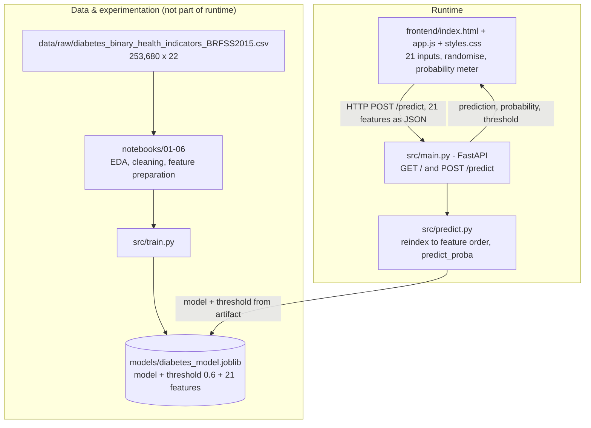

# HealthLens — CDC Diabetes Health Indicators

An end-to-end machine learning project that predicts diabetes risk from public health indicators, served through a FastAPI backend and a browser-based prediction UI.

**Author:** Muhammad Ammar ·
| | |
|---|---|
| **Task** | Binary classification (`Diabetes_binary`: 0 = no diabetes, 1 = diabetes/prediabetes) |
| **Data** | CDC Diabetes Health Indicators (BRFSS 2015) — 253,680 rows × 22 columns raw → 229,474 × 22 after cleaning |
| **Final model** | Logistic Regression (balanced), decision threshold 0.6 |
| **Final test metrics** | Accuracy 0.775 · PR-AUC 0.412 · class-1 Precision 0.366 / Recall 0.642 / F1 0.466 |
| **Stack** | Python · scikit-learn · imbalanced-learn · joblib · FastAPI/Uvicorn · vanilla HTML/CSS/JS |
| **Status** | Local end-to-end flow verified working. **Not deployed.** No test suite. Not containerised. |

> **Not a medical device.** This model outputs a statistical risk estimate from survey indicators. It is **not** a diagnosis, does not replace clinical testing, and must not be used to make health decisions.
>
> **Documentation scope.** Everything below was verified by inspecting the notebooks, source, artifacts and application, and by executing the model artifact and API locally. Hosting limits in [§10](#10-deployment) come from external vendor documentation and are labelled as such. Anything not verifiable from the repository is marked **TODO**.

---

## Table of Contents

1. [Project Overview](#1-project-overview)
2. [Dataset](#2-dataset)
3. [Exploratory Data Analysis](#3-exploratory-data-analysis)
4. [Data Preprocessing](#4-data-preprocessing)
5. [Model Development & Evaluation](#5-model-development--evaluation)
6. [Final Model](#6-final-model)
7. [System Architecture](#7-system-architecture)
8. [Backend & Frontend](#8-backend--frontend)
9. [Installation & Usage](#9-installation--usage)
10. [Deployment](#10-deployment)
11. [Limitations & Future Improvements](#11-limitations--future-improvements)
12. [Project Structure & Technologies](#12-project-structure--technologies)

---

## 1. Project Overview

**Problem.** Diabetes and prediabetes often go undetected because diagnosis requires a blood test. Large public health surveys such as the CDC's Behavioral Risk Factor Surveillance System (BRFSS) collect cheap, self-reported indicators — blood pressure history, BMI, general health, age, activity — that correlate with diabetes status. A model that estimates risk from those indicators can support **triage and awareness**, flagging people who may benefit from an actual screening.

**Objectives**

- Explore and clean the BRFSS 2015 diabetes dataset and justify every preprocessing decision from the data.
- Establish baseline performance for several classifiers on an imbalanced target.
- Test whether class-imbalance handling (class weights, over/under-sampling, SMOTE) actually improves the metric that matters — **recall on the positive class** — rather than just accuracy.
- Tune and threshold the selected model without touching the test set until decisions are frozen.
- Ship the model behind a documented REST API and a usable web interface.

**Input / output.** Input is 21 numeric feature values describing one person. Output is a binary class (`0`/`1`), the positive-class probability, and the decision threshold used — so the caller can see how close the decision was.

**End-to-end workflow**

```text
BRFSS 2015 raw CSV (253,680 × 22)
   └─ 01 initial exploration ──► 02 cleaning (dedupe) ──► 03/04/05 EDA
        └─ 06 feature preparation (train/test split) ──► 07 modeling, tuning, thresholding
             └─ models/diabetes_model.joblib  {model, threshold=0.6, features}
                  └─ FastAPI (src/main.py)  ──►  Web UI (frontend/)
```

---

## 2. Dataset

**Source.** [CDC Diabetes Health Indicators](https://archive.ics.uci.edu/dataset/891/cdc+diabetes+health+indicators) (UCI ML Repository, dataset ID 891, DOI `10.24432/C53919`), derived from the CDC BRFSS 2015 survey. The repository ships **no** download script or URL — the raw file was placed manually, so the exact acquisition path and access date are **TODO**. The raw CSV in the working tree is dated `2021-11-08`; before redistribution, confirm UCI/CDC usage terms (no license statement is included in this repository).

| Property | Value |
|---|---|
| Raw shape | 253,680 rows × 22 columns |
| Cleaned shape | 229,474 rows × 22 columns |
| Train / test split | 183,579 / 45,895 (80/20, stratified, `random_state=42`) |
| Model features | 21 (all columns except the target) |
| Missing values | 0 |
| Dtype | All columns numeric (`float64`); the published schema is integers 0/1 for binary flags |
| Target | `Diabetes_binary` — 0 = no diabetes (84.71%), 1 = diabetes/prediabetes (15.29%) |
| Class ratio | ≈ 5.5 : 1 (moderately imbalanced) |

**Features, grouped as the modeling pipeline treats them**

| Group | Columns | Notes |
|---|---|---|
| Numeric (3) | `BMI`, `MentHlth`, `PhysHlth` | `BMI` 12–98 (84 distinct values); `MentHlth`/`PhysHlth` = poor mental/physical health days in the last 30 (0–30) |
| Binary (14) | `HighBP`, `HighChol`, `CholCheck`, `Smoker`, `Stroke`, `HeartDiseaseorAttack`, `PhysActivity`, `Fruits`, `Veggies`, `HvyAlcoholConsump`, `AnyHealthcare`, `NoDocbcCost`, `DiffWalk`, `Sex` | 0/1 |
| Ordinal (4) | `GenHlth` (1 excellent → 5 poor), `Education` (1–6), `Income` (1–8), `Age` (1–13, 5-year bands) | Ordinal, **not** scaled in this project |

**Data-quality findings (from [02_data_cleaning.ipynb](notebooks/02_data_cleaning.ipynb))**

- No missing values and no out-of-range categorical codes.
- 24,206 exact duplicate rows (9.54% of the raw file) — removed.
- 1,566 feature combinations appear with **both** labels (5,218 rows); these are label conflicts, not duplicates. They were kept, which imposes an accuracy ceiling on the data itself.
- IQR outliers in `BMI` (9,847), `MentHlth` (36,208) and `PhysHlth` (40,949) were **retained** — all values are inside the survey's documented valid ranges.

---

## 3. Exploratory Data Analysis

Each numbered notebook is documented once, in the lifecycle stage where it belongs.

### 3.1 [01_initial_exploration.ipynb](notebooks/01_initial_exploration.ipynb) — Dataset inspection

**Purpose:** confirm size, schema and data quality before any transformation.

**Steps:** `shape` and `info()` → missing-value counts → duplicate count → `describe()` → target `value_counts()` → categorical value counts.

**Findings:** shape `(253,680, 22)`; zero missing values; 24,206 duplicate rows; target `218,334` zeros vs `35,346` ones (86.07% / 13.93%); `BMI` spans 12–98 with mean 28.38; `Sex` 44.0% male; `DiffWalk` 16.8%.

**Conclusion:** the file is complete but duplicated; the target is imbalanced enough that accuracy alone will be misleading. Both facts drive the rest of the project.

### 3.2 [03_univariate_analysis.ipynb](notebooks/03_univariate_analysis.ipynb) — Single-feature distributions

**Purpose:** understand each feature's shape and spot encoding problems.

**Findings (cleaned data, n = 229,474)**

- `BMI`: mean 28.69, median 27, std 6.79, skewness **2.06** — right-skewed, a minority of high-BMI records pull the tail.
- Ordinal/binary variables are dominated by a few categories: `GenHlth` = 2 (33.7%), `Education` = 6 (38.5%), `Income` = 8 (31.2%), `Age` = 9 (12.9%); rare categories exist (e.g. `Education` = 1 for 0.08%, `Income` = 1 for 4.3%).
- Binary flags are strongly one-sided: `CholCheck` 95.9% yes, `AnyHealthcare` 94.6%, but `Stroke` only 4.5% and `HvyAlcoholConsump` 6.1%.

**Conclusion:** distributions are plausible for survey data — no invalid codes. The skew in `BMI` and the very low-variance binary flags are handled later by scaling and by not over-interpreting feature importance.

### 3.3 [04_bivariate_analysis.ipynb](notebooks/04_bivariate_analysis.ipynb) — Each feature vs the target

**Purpose:** rank features by association with `Diabetes_binary` and test the numeric ones properly.

**Methods:** chi-square + Phi coefficient for binary/ordinal features; chi-square + Cramér's V for multi-level ordinal features; Mann–Whitney U with rank-biserial effect size for `BMI`/`MentHlth`/`PhysHlth`.

**Findings**

| Feature | Test | Statistic | Effect size |
|---|---|---|---|
| `GenHlth` | χ² | 18,193.70 | Cramér's V 0.282 |
| `HighBP` | χ² | 14,840.42 | Phi 0.254 |
| `DiffWalk` | χ² | 9,670.63 | Phi 0.205 |
| `HighChol` | χ² | 8,719.66 | Phi 0.195 |
| `Age` | χ² | 8,207.83 | Cramér's V 0.189 |
| `HeartDiseaseorAttack` | χ² | 6,491.59 | Phi 0.168 |
| `Income` | χ² | 4,637.20 | Cramér's V 0.142 |
| `PhysActivity` | χ² | 2,312.70 | Phi 0.100 |
| `BMI` | Mann–Whitney U | 2,220,444,097 | rank-biserial 0.349 (p ≈ 0) |

All associations are statistically significant (expected at n = 229k); the effect sizes are what matter. They are small-to-moderate, so no single feature is close to predictive on its own.

**Conclusion:** general health, blood-pressure history, walking difficulty, cholesterol and age are the leading signals; `BMI` separates the two classes most strongly among the numerics. This justified keeping the full feature set rather than aggressively pruning.

### 3.4 [05_multivariate_analysis.ipynb](notebooks/05_multivariate_analysis.ipynb) — Feature interactions

**Purpose:** check whether associations change when features are combined.

**Steps:** diabetes rate (%) by `Age × HighBP`, by `HighBP × HighChol`, and by derived `BMI` bands (`pd.cut`) against the target.

**Conclusion:** risk rises monotonically with age and with the number of coexisting risk factors — diabetes rate climbs stepwise as `HighBP`/`HighChol`/high-BMI accumulate. This supports a model that can use additive feature combinations and made a linear baseline a reasonable starting point. *(Known issue: the notebook's title cell says "04 — Multivariate Analysis"; the filename and its position in the sequence are authoritative.)*

### 3.5 EDA findings that changed the design

1. **Imbalance is real** (13.9% positives) → optimise F1 / recall / PR-AUC, never accuracy alone; evaluate resampling strategies.
2. **Associations are individually weak** → keep all 21 features, expect a modest PR-AUC rather than a near-perfect classifier.
3. **`BMI` is skewed with valid extremes** → scale it, do not clip it.
4. **Duplicates carry conflicting labels** → perfect separability is impossible; report metrics with that caveat.

---

## 4. Data Preprocessing

### 4.1 [02_data_cleaning.ipynb](notebooks/02_data_cleaning.ipynb) — Cleaning

| Step | Action | Result |
|---|---|---|
| 1 | Inspect shape / dtypes / missing values | 253,680 × 22, 0 missing |
| 2 | Identify duplicates | 24,206 duplicate rows; 35,575 rows sit in duplicate groups |
| 3 | Test label consistency inside duplicate groups | 1,566 feature combinations carry both labels (5,218 rows) |
| 4 | Drop exact duplicates (`drop_duplicates()`) | **229,474 × 22** |
| 5 | IQR outlier check on `BMI` / `MentHlth` / `PhysHlth` | 9,847 / 36,208 / 40,949 flagged — all retained (valid survey ranges) |
| 6 | Save | `data/processed/diabetes_cleaned.csv` |

**Decision:** de-duplicate only. Conflicting-label rows are real survey responses with identical answers, so removing them would discard genuine data and bias the sample; keeping them is documented as a limitation.

### 4.2 [06_feature_engineering_preparation.ipynb](notebooks/06_feature_engineering_preparation.ipynb) — Feature preparation

**Purpose:** decide what preprocessing is needed, then split and freeze the matrices.

**Steps:** load the cleaned CSV (229,474 × 22) → separate `y = Diabetes_binary`, `X` = the other 21 columns → verify no further feature engineering is required (the 14 binary flags are already 0/1; the 4 ordinals are already monotonic codes) → `train_test_split(test_size=0.2, stratify=y, random_state=42)`.

**Outputs written to `data/processed/prepared/`:** `X_train.csv` (183,579 × 21), `X_test.csv` (45,895 × 21), `y_train.csv`, `y_test.csv`. Stratification held: the training target is 84.705% / 15.295%, the test target 84.706% / 15.294%.

**Decision:** no new features were engineered. Scaling was deliberately **excluded** from this step so that it can be fitted inside the model pipeline (see below).

### 4.3 Preprocessing as actually implemented

Scaling lives **inside** the model pipeline, so cross-validation refits it per fold:

```python
numeric_features = ["BMI", "MentHlth", "PhysHlth"]

preprocessor = ColumnTransformer(
    transformers=[("num", StandardScaler(), numeric_features)],
    remainder="passthrough",   # 14 binary + 4 ordinal columns pass through unscaled
)
```

- **Fitted only on training data.** `StandardScaler` is fitted inside the pipeline (and inside `GridSearchCV`/`cross_validate` folds), never on the full dataset.
- **Encoding:** none applied — binary flags and ordinal codes are fed to Logistic Regression as numeric inputs, which is acceptable for a linear model on already-monotonic codes but leaves ordinal spacing (e.g. `Age` bands) unmodelled. Logged as a limitation.
- **Imbalance handling:** not applied to the final model's data; instead `class_weight="balanced"` is used (see [§5](#5-model-development--evaluation)). Resampling variants were evaluated with `imblearn` pipelines so that sampling happens only inside training folds.
- **Split:** single stratified 80/20 split, `random_state=42`, before any scaling.
- **Leakage risks (disclosed, not hidden):**
  - The **test set was reused** for exploratory baseline comparison in notebook 07 before tuning. The notebook states this limitation itself (§0, §5, §12, §13), and the reported test numbers are therefore optimistic relative to a pristine hold-out.
  - Threshold selection avoided the test set by carving a 20% validation split out of the training data (`random_state=42`, stratified).

---

## 5. Model Development & Evaluation

### 5.1 [07_modeling_evaluation.ipynb](notebooks/07_modeling_evaluation.ipynb) — Modeling & evaluation

**Purpose:** baseline the candidate algorithms, compare them under cross-validation, tune Logistic Regression, and select a decision threshold — using only training data for selection.

**Setup:** `StratifiedKFold(5)` on the training set; every model wrapped in a `Pipeline`; metrics = F1, recall and average precision (PR-AUC) on the positive class. Positive class = `1`.

**Baselines on the test set** — *exploratory only*, because this set was also used for later comparisons:

| Model | Accuracy | Precision (1) | Recall (1) | F1 (1) |
|---|---|---|---|---|
| Logistic Regression (unweighted) | 0.8506 | 0.5405 | 0.1532 | 0.2387 |
| Logistic Regression (`balanced`) | 0.7143 | 0.3182 | 0.7595 | 0.4485 |
| Decision Tree | 0.7739 | 0.2864 | 0.3208 | 0.3027 |
| Random Forest | 0.8431 | 0.4639 | 0.1675 | 0.2462 |
| KNN | 0.8340 | 0.4164 | 0.2133 | 0.2821 |

**Primary comparison — 5-fold CV on the training set (mean):**

| Configuration | F1 | Recall | PR-AUC |
|---|---|---|---|
| Logistic Regression, `balanced` | 0.450 | 0.754 | 0.404 |
| Logistic Regression + RandomOverSampler | 0.449 | 0.754 | 0.404 |
| Logistic Regression + RandomUnderSampler | 0.449 | 0.755 | 0.404 |
| Logistic Regression + SMOTE | 0.448 | 0.748 | 0.401 |
| Random Forest + RandomUnderSampler | 0.433 | 0.755 | 0.378 |
| Random Forest, `balanced` | 0.407 | 0.422 | 0.351 |
| Random Forest + RandomOverSampler | 0.348 | 0.298 | 0.345 |
| Random Forest + SMOTE | 0.266 | 0.189 | 0.353 |
| Decision Tree, `balanced` | 0.301 | 0.320 | 0.196 |
| KNN, `balanced` | 0.276 | 0.208 | 0.283 |
| Logistic Regression (unweighted) | 0.232 | 0.148 | **0.406** |

**Tuning.** `GridSearchCV` with the same 5-fold stratified CV, scoring F1/recall/average precision:

```python
param_grid = {
    "model__C": [0.01, 0.1, 1, 10],
    "model__class_weight": [None, "balanced"],
    "model__solver": ["lbfgs"],      # fixed, not searched
}
# Best: {'model__C': 1, 'model__class_weight': 'balanced', 'model__solver': 'lbfgs'}
# Best mean CV F1: 0.4494718286310978
```

**Threshold selection.** A 20% stratified validation split of the training set (`random_state=42`); thresholds 0.3–0.7 evaluated on validation only:

| Threshold | Precision (1) | Recall (1) | F1 (1) |
|---|---|---|---|
| 0.3 | 0.247 | 0.919 | 0.389 |
| 0.4 | 0.283 | 0.847 | 0.425 |
| 0.5 | 0.323 | 0.751 | 0.452 |
| **0.6** | **0.371** | **0.633** | **0.468** |
| 0.7 | 0.426 | 0.471 | 0.448 |

0.6 maximises validation F1 and raises precision substantially while keeping recall above 0.6 — the deliberate choice for a screening-style use case.

**Final evaluation on the test set at threshold 0.6 (single, post-decision run):**

| Metric | Value |
|---|---|
| Accuracy | 0.7749 |
| Average Precision (PR-AUC) | 0.4121 |
| Precision (class 1) | 0.366 |
| Recall (class 1) | 0.642 |
| F1 (class 1) | 0.466 |
| Confusion matrix | `[[31058, 7818], [2512, 4507]]` → TN 31,058 · FP 7,818 · FN 2,512 · TP 4,507 |

**Why this model.** Logistic Regression with balanced class weights was the best F1 configuration under cross-validation (0.450), matched by the resampling variants within noise (≤0.002) while being far simpler to deploy and inspect. Random Forest with undersampling came close on F1 (0.433) but trains and scores far larger artifacts. The unweighted model has the highest PR-AUC (0.406) yet a near-useless recall of 0.148 — ranking well while refusing to flag anyone, which is the wrong trade-off here. A linear model on scaled features therefore won on the project's own selection criterion.

**Metric discrepancy — read carefully.** The balanced Logistic Regression F1 appears as three different numbers, and all three are correct in context:

| Value | Where | Meaning |
|---|---|---|
| 0.4485 | Test set at the default 0.5 threshold, exploratory baseline | The out-of-the-box decision rule, before any tuning |
| 0.450 | 5-fold CV, threshold 0.5 | Mean cross-validated estimate used for model selection |
| 0.466 | Test set, threshold **0.6** | Final configuration, post-decision evaluation |

Never quote one without its threshold. `src/train.py` hard-codes the final configuration (`C=1`, `class_weight="balanced"`, `max_iter=2000`, `THRESHOLD=0.6`), and the saved artifact's hyperparameters match the GridSearch winner, so the app is running the tuned model — not a baseline.

---

## 6. Final Model

**Artifact:** [`models/diabetes_model.joblib`](models/diabetes_model.joblib) (3,750 bytes) — a single dict:

| Key | Type | Value |
|---|---|---|
| `model` | `sklearn.pipeline.Pipeline` | `ColumnTransformer`(StandardScaler on BMI/MentHlth/PhysHlth) → `LogisticRegression(C=1, class_weight="balanced", solver="lbfgs", max_iter=2000, random_state=42)` |
| `threshold` | `float` | `0.6` |
| `features` | `list[str]` | the 21 feature names **in training order** |

The dict format is deliberate: scaler, estimator, decision threshold and expected column order travel together, so the API cannot silently use a different threshold or a shuffled column order. It is created by [`src/train.py`](src/train.py), which reads `data/processed/prepared/X_train.csv` + `y_train.csv` and dumps the artifact.

**Expected features** (exact order enforced at inference):

```text
HighBP, HighChol, CholCheck, BMI, Smoker, Stroke, HeartDiseaseorAttack,
PhysActivity, Fruits, Veggies, HvyAlcoholConsump, AnyHealthcare, NoDocbcCost,
GenHlth, MentHlth, PhysHlth, DiffWalk, Sex, Age, Education, Income
```

**Inference** ([`src/predict.py`](src/predict.py)) — raw input is reindexed to the stored feature order, so the scaler sees columns exactly as it was fitted:

```python
def predict(input_data: dict) -> dict:
    missing_features = set(FEATURES) - set(input_data)
    if missing_features:
        raise ValueError(f"Missing features: {sorted(missing_features)}")

    input_df = pd.DataFrame([{feature: input_data[feature] for feature in FEATURES}])
    probability = float(model.predict_proba(input_df)[0, 1])
    prediction = int(probability >= THRESHOLD)
    return {"prediction": prediction, "probability": round(probability, 4), "threshold": THRESHOLD}
```

**What the app returns:** a class label (`0`/`1`), the positive-class probability rounded to 4 dp, and the threshold — never a bare "yes/no". Example (verified by running the API locally):

```json
{ "prediction": 0, "probability": 0.2854, "threshold": 0.6 }
```

**Compatibility.** Trained and verified with scikit-learn 1.9.1 / joblib 1.6.0. Loading the artifact under a different scikit-learn version may emit `InconsistentVersionWarning`; pin the version or retrain (see [§9](#9-installation--usage)).

**Verification level.** The artifact was loaded and executed locally, its keys/params/threshold/feature order inspected, and the live API returned matching predictions. Training-vs-serving preprocessing **is** consistent: both use the pipeline stored inside the artifact.

---

## 7. System Architecture



The notebooks and `src/train.py` are offline/development-time only; the runtime path is artifact → API → browser. Training and serving share one artifact, which is what keeps their preprocessing identical.

---

## 8. Backend & Frontend

### 8.1 API ([`src/main.py`](src/main.py))

| Method | Path | Purpose | Request | Response |
|---|---|---|---|---|
| `GET` | `/` | Liveness check | — | `{"message": "Diabetes Prediction API is running"}` |
| `POST` | `/predict` | Predict | `{"features": {<21 numeric fields>}}` | `{"prediction": 0\|1, "probability": float, "threshold": 0.6}` |

There is **no** `/health` endpoint — `/` serves that purpose, and it does not check the artifact.

**Request schema.** Pydantic model with `features: dict[str, float]`. All 21 keys must be present; unknown keys are ignored.

```bash
curl -X POST http://127.0.0.1:8000/predict \
  -H "Content-Type: application/json" \
  -d '{"features":{"HighBP":1,"HighChol":1,"CholCheck":1,"BMI":31,"Smoker":0,"Stroke":0,
       "HeartDiseaseorAttack":0,"PhysActivity":1,"Fruits":1,"Veggies":1,"HvyAlcoholConsump":0,
       "AnyHealthcare":1,"NoDocbcCost":0,"GenHlth":3,"MentHlth":4,"PhysHlth":6,"DiffWalk":0,
       "Sex":1,"Age":9,"Education":5,"Income":6}}'
```

**Validation & errors.**

- Missing feature names → the API raises a 422 whose `detail` lists the missing fields (`"Missing features: [...]"`) — verified by calling the endpoint with an incomplete payload.
- A malformed body (missing `features`, non-numeric values) → FastAPI's standard 422 schema validation error.
- Range checks are **not** enforced server-side (e.g. a negative `BMI` is accepted and will produce a meaningless probability). This is a known gap, listed in [§11](#11-limitations--future-improvements).
- Model loading is a module-level import (`_ensure_loaded()` in `predict.py`); if the artifact is unreadable the app fails at import/startup rather than per request.

**CORS.** `CORSMiddleware` currently allows `http://127.0.0.1:5500`, `http://localhost:5500` and the literal origin `"null"` (which browsers send for `file://` pages). The deployed frontend's origin must be added here or every request will fail preflight. `allow_credentials=True` combined with `"null"` is loose by default — tighten both before exposing the API publicly.

### 8.2 Web frontend ([`frontend/`](frontend))

Static, dependency-free HTML/CSS/JS — three files plus a logo widget. It mirrors the model's 21 features one-to-one:

| UI control | Features |
|---|---|
| Numeric inputs / sliders | `BMI` (12–60), `MentHlth`, `PhysHlth` (0–30) |
| Dropdowns | `Age`, `Education`, `Income`, and `GenHlth` |
| Mutually exclusive radio pair | `Sex` (Female/Male — selecting one deselects the other, default Female only) |
| Checkboxes (13) | `HighBP`, `HighChol`, `CholCheck`, `Smoker`, `Stroke`, `HeartDiseaseorAttack`, `PhysActivity`, `Fruits`, `Veggies`, `HvyAlcoholConsump`, `AnyHealthcare`, `NoDocbcCost`, `DiffWalk` |

Behaviour worth knowing:

- **`GenHlth` is displayed inverted.** The dropdown shows Excellent→Poor for humans and sends `6 - selected` to match the survey's 1–5 encoding.
- **Randomise Inputs** fills every control with random but valid values and clears any previous result.
- **Prediction flow:** collect → build the 21-key `features` object → `POST /predict` → render probability bar, predicted class, and a disclaimer. Network or HTTP errors surface as a readable message instead of a silent failure.
- **Design system:** tokens in [`styles.css`](frontend/styles.css) — background `#fff8f5`, accent `#f04b24`, success `#15803d`, dark text `#29201d`. The animated logo is a self-contained SVG ([`logo-animated.html`](frontend/logo-animated.html), ~207 KB) embedded in an `iframe`, supporting `?color=#RRGGBB`; it does not affect prediction logic.
- **API URL:** `API_BASE = "http://127.0.0.1:8000"` is hard-coded on line 1 of [`app.js`](frontend/app.js#L1) and must be changed to the public backend URL for any deployment.

> `127.0.0.1` always means *the machine running the browser*. On any other device it will point at that device, not at your server — hence the need to replace it with the deployed API URL (and to add the frontend's origin to the API's CORS list).

---

## 9. Installation & Usage

**Prerequisites.** Python 3.10+ (verified with 3.12.14). No Node.js required — the frontend is static. The dataset and the trained artifact are both required: the repo ships the artifact, but `data/` is git-ignored.

```bash
# 1. Clone
git clone https://github.com/mu-3mar/cdc-diabetes-health-indicators.git
cd cdc-diabetes-health-indicators

# 2. Create an environment
python -m venv .venv && source .venv/bin/activate     # macOS/Linux
# python -m venv .venv && .venv\Scripts\activate      # Windows

# 3. Install dependencies  (no requirements.txt exists - install explicitly)
pip install "scikit-learn==1.9.1" "pandas==3.0.6" "numpy==2.5.3" "scipy==1.18.1" \
            "joblib==1.6.0" "fastapi==0.162.0" "uvicorn==0.54.0" "imbalanced-learn==0.14.2"

# 4. Place the dataset
#    Download "CDC Diabetes Health Indicators" (UCI ID 891) and put the file at:
#    data/raw/diabetes_binary_health_indicators_BRFSS2015.csv
```

> **`environment.yml` caveat.** The repo contains [environment.yml](environment.yml), but it is named `water-potability`, omits several required packages (no `fastapi`, `uvicorn`, `joblib`, `imbalanced-learn`), and carries a hard-coded `prefix`. Treat it as stale; use the explicit `pip install` above.

```bash
# 5. (Optional) Retrain - reproduces models/diabetes_model.joblib
#    Requires data/processed/diabetes_cleaned.csv and data/processed/prepared/*.csv
#    (produced by notebooks 02 and 06).
python src/train.py

# 6. Start the API  (run from the repository root)
uvicorn src.main:app --reload
# -> http://127.0.0.1:8000          interactive docs: /docs

# 7. Serve the frontend  (in a second terminal)
python -m http.server 5500 --directory frontend
# -> http://127.0.0.1:5500
```

**Verify the full flow**

```bash
curl http://127.0.0.1:8000/          # {"message":"Diabetes Prediction API is running"}
# then POST /predict as shown in 8.1 - expect {"prediction":..., "probability":..., "threshold":0.6}
```

Open `http://127.0.0.1:5500`, fill the form (or press **Randomise Inputs**), submit, and confirm a probability appears. Browser devtools → Network should show a `200` on `POST http://127.0.0.1:8000/predict`.

**Reproducing from raw data:** run the notebooks in order, `01 → 07`. Notebooks 02 and 06 write the CSVs that `src/train.py` consumes; notebook 07 produces the metrics in [§5](#5-model-development--evaluation). Notebook 07's exploratory cells re-fit several models and take noticeably longer than the rest.

---

## 10. Deployment

> **Current status: not deployed.** There is no `Dockerfile`, no `vercel.json`, no CI workflow, no hosting configuration and no public URL in this repository. Everything in this section is a **plan**, and each step below is future work. Hosting numbers come from vendor documentation (August–October 2026) and must be re-checked against official pages before you rely on them.

### 10.1 Vercel

- **Static frontend — good fit.** `frontend/` is plain HTML/CSS/JS and can be deployed as a static site with no build step. The only change needed is `API_BASE` in `app.js` pointing at a public API URL.
- **FastAPI backend — technically possible, operationally risky.** Vercel runs Python as serverless functions, which suits this app's dependency set but not its lifecycle:

| Limit (Hobby) | Value | Implication here |
|---|---|---|
| Max function duration | 300 s (default and maximum) | Peak is fine; cold starts dominate latency |
| Memory / CPU | 2 GB / 1 vCPU, fixed | Ample — the artifact is 3.75 KB |
| Bundle size (uncompressed) | 250 MB, 500 MB for Python (up to 5 GB via *Large functions*, beta) | scikit-learn + SciPy + pandas + joblib must fit; verify with a real build, not an estimate |
| Request/response payload | 4.5 MB | Irrelevant for 21 scalars |
| Concurrency | Auto-scales (Hobby) | Fine |
| Region | Single region by default (`iad1`) | Latency for non-US users unless changed |

  The real costs are: cold starts while a large scientific-Python bundle initialises, the model being reloaded per instance, and needing to add the frontend origin to CORS after the backend URL is known.

### 10.2 Oracle Cloud Infrastructure (Always Free)

- **Fits the application well.** An always-on Linux VM can run Uvicorn (directly or in Docker) 24/7 with no cold starts and no per-request limits — the opposite trade-off from serverless, and better suited to a persistent Python model.
- **Always Free compute.** A1.Flex (Arm): **1,500 OCPU-hours + 9,000 GB-hours per month**, i.e. the equivalent of **2 OCPUs / 12 GB** running continuously, or two 1-OCPU instances. This was **halved from 4 OCPUs / 24 GB (3,000 / 18,000) in June 2026**; some official pages still display the older figures, so confirm your tenancy's quota in the console. Also included: two AMD micro instances (`VM.Standard.E2.1.Micro`), 200 GB block storage (min 47 GB boot volume per instance), and 10 TB/month outbound.
- **Constraints to plan for:** Arm64 images only (verify every wheel builds for `aarch64`), capacity is not guaranteed in a given availability domain ("out of host capacity" is common), instances are the free tier with no SLA, and idle Always Free instances can be reclaimed (roughly: CPU 95th-percentile < 20%, network < 20%, and memory < 20% sustained over ~7 days) — so keep the service genuinely active or expect reclamation.
- **Networking/security to add:** open only 443 (and 22 for SSH) in both the VCN security list *and* the instance's local firewall; put Nginx or Caddy in front of Uvicorn as a reverse proxy; obtain TLS from Let's Encrypt; run Uvicorn bound to `127.0.0.1` behind the proxy; add the frontend origin to CORS; configure `systemd` (or a container restart policy) so the API survives reboots.

Sources: [Vercel Functions limits](https://vercel.com/docs/functions/limitations) · [OCI Always Free resources](https://docs.oracle.com/en-us/iaas/Content/FreeTier/freetier_topic-Always_Free_Resources.htm)

### 10.3 Recommended path for this project

**Frontend on Vercel, API on an OCI Always Free VM.** The frontend is exactly what a static host is for; the API is a long-lived process holding a loaded model, which is what a VM is for. Vercel-only is cheaper to start but pays for it in cold-start latency and a heavier scientific-Python bundle; OCI-only is viable (serve `frontend/` from the same Nginx) if you would rather manage one origin.

Phased checklist — **all steps are unstarted**:

1. [ ] Add `requirements.txt` pinned to the versions in [§9](#9-installation--usage), and make the dataset path configurable.
2. [ ] Decide artifact delivery (commit it, or download at container start) and confirm it loads on the target platform/architecture.
3. [ ] Harden the API: enforce input ranges, remove the `"null"` CORS origin, disable `allow_credentials` unless needed, add real logging.
4. [ ] Provision the OCI VM and run the API behind a `systemd` unit or a container.
5. [ ] Verify `GET /` and `POST /predict` from *outside* the VM and note the public URL.
6. [ ] Deploy `frontend/` to Vercel as a static site.
7. [ ] Set `API_BASE` in `app.js` to the public URL and redeploy.
8. [ ] Enable HTTPS (Let's Encrypt) and restrict CORS to the exact frontend origin; re-test the `OPTIONS` preflight.
9. [ ] Run the full flow from a different device/network.
10. [ ] Write down rollback, log locations, resource limits and a monitoring/maintenance routine.

---

## 11. Limitations & Future Improvements

**Technical limitations (verified in the repository)**

- **Test-set reuse.** Baselines in notebook 07 were compared on the test set before tuning, so final metrics are mildly optimistic. The notebook discloses this; a clean re-split should confirm the numbers.
- **Label conflicts.** 5,218 rows share identical features with opposite labels — a hard accuracy ceiling that no model can remove.
- **No server-side input validation.** `/predict` accepts any float, including impossible values (negative BMI, `GenHlth` = 99).
- **Ordinal features are treated as plain numbers** (not scaled, not one-hot, not target-encoded), so the model assumes equal, linear spacing between e.g. `Age` bands.
- **Accuracy is dominated by the majority class**; PR-AUC 0.412 and precision 0.366 mean roughly two in three positive flags are false alarms at threshold 0.6.
- **Weak deployment posture:** `"null"` in the CORS allow-list with credentials enabled, no authentication, no rate limiting, no `/health` endpoint, no structured logging, no `requirements.txt`, a stale `environment.yml`.
- **Minor documentation defects:** notebook 05's title cell reads "04"; notebook 07 §11 refers to a "previous threshold analysis" that does not exist in the notebook; `src/main.py` imports `CORSMiddleware` twice.

**Future improvements, in priority order**

1. **Deploy** the recommended [§10.3](#103-recommended-path-for-this-project) path — the single largest gap between this project and a usable product.
2. **Add a test suite** — at minimum: artifact key/shape checks, a `/predict` contract test, a "missing feature → 422" test, and a regression test locking the feature order. None exist today.
3. **Harden the API** — range validation via Pydantic constraints, strict CORS, authentication, rate limiting, a real `/health`.
4. **Re-split and re-evaluate** onto a genuinely untouched hold-out to publish honest final numbers.
5. **Improve the model honestly** — probability calibration, non-linear models with proper cost-sensitive tuning, or ordinal-aware encoding for `Age`/`Education`/`Income`; compare against the current PR-AUC 0.412 rather than against accuracy.
6. **Fix the defects** listed above and document the *prevalence* context (PR-AUC vs. the 15.3% base rate) in the UI.
7. **Add packaging** — `requirements.txt`, a `Dockerfile`, and CI to run the tests and rebuild the artifact reproducibly.

---

## 12. Project Structure & Technologies

```text
cdc-diabetes-health-indicators/
├── README.md                                  # this document
├── environment.yml                            # stale/incomplete - see 9
├── .gitignore                                 # ignores data/, caches, venv
├── notebooks/                                 # the full experimentation lifecycle
│   ├── 01_initial_exploration.ipynb            # shape, missing values, duplicates, target balance
│   ├── 02_data_cleaning.ipynb                  # dedupe + IQR review -> diabetes_cleaned.csv
│   ├── 03_univariate_analysis.ipynb            # per-feature distributions
│   ├── 04_bivariate_analysis.ipynb             # chi-square / Phi / Cramer's V / Mann-Whitney
│   ├── 05_multivariate_analysis.ipynb          # feature interactions vs diabetes rate
│   ├── 06_feature_engineering_preparation.ipynb# feature review, 80/20 stratified split, save prepared CSVs
│   └── 07_modeling_evaluation.ipynb            # baselines, CV, GridSearch, thresholds, final evaluation
├── src/
│   ├── train.py                               # fits the final pipeline, dumps {model, threshold, features}
│   ├── predict.py                             # loads the artifact, validates input, predict_proba
│   └── main.py                                # FastAPI app: GET /, POST /predict, CORS
├── models/
│   └── diabetes_model.joblib                  # 3,750 B - the served artifact
├── frontend/
│   ├── index.html                             # form with 21 model inputs
│   ├── app.js                                 # API_BASE, payload build, result rendering
│   ├── styles.css                             # design tokens, layout, probability meter
│   └── logo-animated.html                     # self-contained animated SVG logo widget
└── data/                                      # git-ignored, not shipped
    ├── raw/diabetes_binary_health_indicators_BRFSS2015.csv     # 253,680 x 22 (+ .zip)
    └── processed/
        ├── diabetes_cleaned.csv               # 229,474 x 22 (notebook 02)
        └── prepared/{X_train,X_test,y_train,y_test}.csv        # notebook 06
```

Not present (verified): `requirements.txt`, `tests/`, `Dockerfile`, `docker-compose.yml`, `.github/workflows/`, any `LICENSE`, or any deployment config.

| Layer | Technologies actually used |
|---|---|
| Data & analysis | pandas, NumPy, Matplotlib/Seaborn, SciPy |
| Modeling | scikit-learn (`Pipeline`, `ColumnTransformer`, `StandardScaler`, `LogisticRegression`, `RandomForestClassifier`, `DecisionTreeClassifier`, `KNeighborsClassifier`, `GridSearchCV`, `StratifiedKFold`, `cross_validate`), imbalanced-learn (`Pipeline`, `RandomOverSampler`, `RandomUnderSampler`, `SMOTE`) |
| Persistence | joblib |
| Backend | FastAPI, Pydantic, Uvicorn |
| Frontend | HTML5, CSS3 (custom properties), vanilla JavaScript, inline SVG |
| Tooling | Jupyter, Git/GitHub |

---

### Author & credits

**Muhammad Ammar** — design, EDA, modeling, API and frontend.

Data: CDC Diabetes Health Indicators, distributed by the UCI Machine Learning Repository (BRFSS 2015; DOI `10.24432/C53919`). Libraries credited to their respective open-source projects. No other collaborators, affiliations or certifications are claimed.

**Remaining TODOs:** confirm the dataset's usage/licence terms, document the exact acquisition URL and date, add a `LICENSE` file, and add the test suite plus deployment configuration described in [§11](#11-limitations--future-improvements) and [§10.3](#103-recommended-path-for-this-project).
